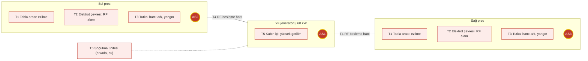
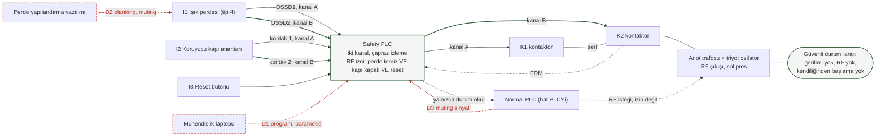

# LABORATUVAR FÖYÜ 1

## Makinenin Emniyet Mimarisi

### 1. hafta

| | |
|---|---|
| **Konu alanı** | Safety Architecture · emniyet fonksiyonları ve ISO 13849-1'e göre PLr |
| **Makine** | Sonar Elektronik Yüksek Frekans Jeneratörü, 60 kW RF çıkış, 13,56 MHz |
| **Hazırlayan** | Beyza Kuzu |

> Bu belge yapay zekâ asistanı Claude (Anthropic) desteğiyle hazırlanmıştır.

## 1. Amaç

Bu föyde Sonar 60 kW yüksek frekans (YF) jeneratörü ve beslediği iki hidrolik presten oluşan yapıştırma hücresi incelenir. Amaç, insanın bu hücrede nereden zarar görebileceğini bulmak ve bu tehlikelere karşı dört emniyet fonksiyonu tanımlamaktır. Her fonksiyonun gerekli performans seviyesi (PLr) ISO 13849-1 risk grafiğiyle belirlenir. Son olarak emniyetin hangi dijital ayarlara ve kişilere bağlı olduğu çıkarılır. Bu son liste Hafta 2'deki bölge tasarımının girdisidir.

## 2. Makine ve kapsam

Jeneratör 13,56 MHz'de çalışan bir dielektrik ısıtıcıdır. Kabindeki osilatörün ürettiği RF enerjisi, yan çıkışlardan pres tablalarındaki elektrotlara taşınır. Üst tabla elektrot, alt tabla toprak tarafıdır. Tutkalın dielektrik kaybı ahşaptan yüksek olduğu için enerji ağırlıkla tutkal hattında ısıya dönüşür. Pres bu sırada parçayı soğuk olarak baskı altında tutar. Üretici, jeneratörün iki çıkışlı olduğunu ve sırayla iki prese enerji verdiğini belirtiyor. Bir pres ısıtılırken diğeri boşaltılıp yeniden doldurulur.

**Tablo 1.** İncelenen makinenin özeti (kaynak: ilan ve üretici sitesi; "varsayım" yazanlar için bkz. makine-bilgisi.md)

| Özellik | Değer |
|---|---|
| Model | 60 kW RF çıkış (ilandaki 30 / 45 / 60 kW seçeneklerinden) |
| Kurulu güç | 90 kVA, 3 faz / 400 V / 50 Hz |
| Frekans | 13,56 MHz |
| RF çıkışı | Sağa ve sola (iki pres) |
| Soğutma | Su (varsayım; kaynakta "hava ya da su") |
| Ölçüler | 1250 × 1250 × 1800 mm (varsayım; ölçü-model eşleşmesi kaynakta yok) |
| Presler | 2 × SPR-120-1: tabla 1600 × 1000 mm, 120 ton (varsayım) |
| Kontrol | Hat PLC'si, dokunmatik HMI, safety PLC, uzak servis yönlendiricisi (varsayım; standart panel analog) |

Standart modelin ürün fotoğrafında panel tamamen analog. Panelde zaman ayarlayıcılar, anot ve grid akımı göstergeleri, koruma lambaları ve bir acil stop var. Bu föyde ise jeneratörün PLC ve HMI ile bir pres hattına bağlandığı bir kurulum ele alınıyor. Dijital bağımlılıklar ancak böyle bir kurulumda ortaya çıkıyor. Bu yüzden kontrol mimarisi baştan sona varsayımdır.

**Kapsam.** Kapsamda jeneratör, iki pres, RF besleme hatları, soğutma ünitesi ve bunların kontrolü var. Tutkal sürme makinesi ve malzeme taşıma kapsam dışında.

**Bir çevrim.**

1. Operatör tutkallı kaplamaları kalıba dizer.
2. Işık perdesi temizken çift el kumandasıyla pres kapanır ve basınç oluşur.
3. PLC "basınç tamam" sinyalini görünce jeneratörden o pres için RF ister.
4. Isıtma süresi boyunca RF verilir.
5. Kısa bir beklemeden sonra pres açılır ve parça alınır.
6. Diğer pres aynı çevrimi yarım çevrim kaydırılmış olarak yapar.

## 3. Uygulama

### 3.1 Şematik çizim ve tehlike bölgeleri

Şekil 1 hücreyi önden gösterir. Çizim ölçekli değildir. Soğutma ünitesi gerçekte jeneratörün arkasındadır, okunabilsin diye yanına çizildi.

**Şekil 1.** Yapıştırma hücresinin önden şematik görünüşü (ölçeksiz). T1–T6 tehlike bölgeleri, AS1–AS3 acil stoplar. AS1 ürün fotoğrafında görülüyor; AS2 ve AS3 pres kumanda kutularında varsayıldı.

**Tablo 2.** Tehlike bölgeleri

| Bölge | Tehlike | Kim, ne zaman maruz kalıyor |
|---|---|---|
| T1 Pres tablaları arası (sol ve sağ) | Kapanan tabla ve kalıp arasında ezilme (120 ton baskı); hidrolik hortum patlaması | Operatör, her çevrimde yükleme ve boşaltmada. Bakımcı, kalıp değişiminde |
| T2 Elektrot ve kalıp çevresi | 13,56 MHz RF alanına maruziyet (iyonlaştırmayan radyasyon); metal parçaya dokununca RF yanığı; kalp pili ve implant taşıyanlar için ek risk (panelde uyarı etiketi var) | Operatör, RF açıkken pres önünde kalırsa. Hücrenin yanından geçen diğer çalışanlar |
| T3 Tutkal hattı ve kalıp içi | Elektrotlar arasında ark (nemli lamel, çivi veya zımba teli, fazla tutkal), kömürleşme, yangın ve duman | Operatör ve çevredekiler, RF sırasında ve hemen sonra |
| T4 RF besleme hattı ve bağlantıları | RF yanığı, kaçak alan; gevşek bağlantıda aşırı ısınma | Bakımcı. Besleme hattının yanından geçenler |
| T5 Jeneratör kabini içi | Anot devresinde yüksek gerilim (triyot osilatörde kV mertebesi, genel bilgi), kondansatörlerde kalan enerji, sıcak triyot | Elektrik bakımcısı ve üretici servisi, kapak açıkken |
| T6 Soğutma devresi | Soğutma kesilirse triyotun aşırı ısınması; yüksek gerilim yakınında su kaçağı; sıcak yüzey | Bakımcı. Arıza anında operatör |

T2 ile T3 diğerlerinden farklı: RF alanı görülmüyor ve hissedilmiyor. Operatör bir tehlikenin içinde olduğunu ancak yanık oluştuğunda anlayabilir. Bu fark, aşağıdaki P parametresi seçimlerinde belirleyici oldu.

### 3.2 Emniyet fonksiyonları ve PLr

ISO 13849-1 risk grafiğinde üç parametre kullanılır:

- **S:** yaralanmanın ağırlığı. S1 hafif ve geri dönüşlü, S2 ağır, kalıcı ya da ölüm.
- **F:** tehlikeye maruz kalma sıklığı ve süresi. F1 seyrek ya da kısa, F2 sık ya da uzun.
- **P:** tehlikeden kaçınma olanağı. P1 belirli koşullarda mümkün, P2 neredeyse imkânsız.

Bu üç parametre sonucunda a'dan e'ye bir PLr verir.

**Tablo 3.** Emniyet fonksiyonları

| No | Emniyet fonksiyonu | Tetikleyen | Güvenli durum |
|---|---|---|---|
| SF-1 | RF enerjisinin kesilmesi: pres önündeki ışık perdesi kesilince ya da yan/arka koruyucu açılınca jeneratör o prese RF vermez, veriyorsa keser | Işık perdesi (OSSD1/OSSD2), koruyucu kapı anahtarı | Anot yüksek gerilimi kesik (K1 ve K2 açık), RF yok. Yeniden başlatma için alan temizlenip reset gerekir |
| SF-2 | Pres kapanmasının durdurulması: kapanma sırasında ışık perdesi kesilirse ya da çift el kumandası bırakılırsa tabla durur | Işık perdesi, çift el kumandası | Kapama valfleri kapalı, hareket yok, basınç tahliye edilmiş |
| SF-3 | Jeneratör kabin kapısı kilidi: kapı, yüksek gerilim kesilip deşarj süresi dolmadan açılmaz; açıkken yüksek gerilim verilemez | Kilitli kapı anahtarı, deşarj zamanlayıcısı | Ana kontaktör açık, anot devresi topraklanmış |
| SF-4 | Acil durdurma: AS1–AS3'ten birine basılınca RF kesilir ve iki presin hareketi durur | Acil stop butonları | SF-1 ve SF-2'deki güvenli durumların ikisi birden |

**Tablo 4.** Risk parametreleri ve PLr

| SF | S | F | P | PLr | Gerekçe |
|---|---|---|---|---|---|
| SF-1 | S2 | F2 | P2 | **e** | RF yanığı derin doku yanığıdır, kalıcı olabilir. Operatör yaklaşık her dakika pres önünde. Alan görünmediği için kaçınma neredeyse yok |
| SF-2 | S2 | F2 | P2 | **e** | 120 ton altında el ezilmesi kalıcıdır. Kapanma hızı bilinmediği için P2 alındı (bkz. açık sorular) |
| SF-3 | S2 | F1 | P2 | **d** | Yüksek gerilimle temas ölümcül olabilir. Kabin yalnızca bakımda açılır. Temas anında kaçınma yok |
| SF-4 | S2 | F1 | P2 | **d** | Tamamlayıcı koruma. Acil stopa gerek duyulan durumlar seyrek ama ağır |

SF-2'de P1 de savunulabilir. Pres yavaş kapanıyorsa ve operatör tablayı görüyorsa el çekilebilir. O zaman PLr d olur. Kapanma hızı ilanda ve üretici sitesinde yok, bu nedenle güvenli tarafta kalındı.

Ark ve aşırı ısınma (T3) bu listeye emniyet fonksiyonu olarak alınmadı. Paneldeki anot ve grid aşırı akım korumaları makineyi korumak için var gibi görünüyor ve PL değerleri bilinmiyor. Hafta 3'teki senaryolar bu kararın yeniden düşünülmesi gerektiğini gösterdi (bkz. Hafta 3, Ö3 ve Hafta 4, GR-4).

### 3.3 SF-1 için giriş–mantık–çıkış şeması

Ayrıntılı çizim için SF-1 seçildi. Bu fonksiyon en yüksek PLr'ye sahip ve doğrudan bu makineye özgü, çünkü RF enerjisini kesiyor. Dijital bağımlılıklarının da en çok olduğu fonksiyon bu.

**Şekil 2.** SF-1 (RF enerjisinin kesilmesi) için giriş–mantık–çıkış şeması. Düz çizgiler iki bağımsız kanal, gri kesikli çizgi normal PLC'nin yalnızca durum okuması, kırmızı kesikli oklar dijital bağımlılıklar (Tablo 6'daki D1–D3).

- **Girişler (I):** Işık perdesi iki bağımsız OSSD çıkışı verir. Koruyucu kapı anahtarının iki ayrı kontağı vardır. Safety PLC iki kanalı karşılaştırır. Kanallar uyuşmazsa ya da test darbesinde hata görülürse fonksiyon güvenli duruma geçer.
- **Mantık (L):** Safety PLC'de iki kanallı mantık çalışır. RF izni ancak iki kanal da "alan temiz" dediğinde ve reset yapılmışsa verilir.
- **Çıkışlar (O):** Anot trafosunun primerinde seri bağlı iki kontaktör (K1, K2) vardır. Zorla kılavuzlu yardımcı kontakları safety PLC'ye geri bildirim (EDM) verir. Kontaktörlerden biri yapışırsa diğeri yine keser ve bir sonraki çevrimde hata yakalanır.
- **Güvenli durum:** Anot gerilimi yok, RF yok, otomatik yeniden başlama yok.

Normal PLC bu yolun içinde değildir. RF'yi yalnızca "istemek" için bir sinyal gönderir. Asıl izin safety PLC'nin kontaktörlerinden geçer. Normal PLC safety PLC'den sadece durum bilgisi okur: perde kesildi, reset bekleniyor, kontaktör hatası gibi.

### 3.4 Normal PLC ve safety PLC karşılaştırması

**Tablo 5.** Normal PLC ve safety PLC karşılaştırması

| Özellik | Normal PLC (hat PLC'si) | Safety PLC |
|---|---|---|
| Bu makinedeki görevi | Pres sırası, RF isteği, ısıtma süresi ve anot akımı reçetesi, alarmlar | SF-1–SF-4: RF'nin ve pres hareketinin ne zaman kesileceği |
| Arıza davranışı | Arızada çıkışın ne yapacağı garanti değil, takılı kalabilir | Kendi arızasını algılar ve güvenli duruma geçer |
| İç yapı | Tek işlemci, tek kanal | İki kanal veya işlemci, çapraz karşılaştırma, giriş ve çıkış testleri |
| Onay | Gerekmez | Belirli PL/SIL için bağımsız kuruluş onaylı |
| Programlama | Serbest dil, sık değişir | Sınırlı ve onaylı fonksiyon blokları; program kontrol toplamıyla (CRC) izlenir; parola korumalı |
| Değişiklik sonrası | Fonksiyon testi | Emniyet doğrulaması (validasyon) tekrarlanır |
| Ağ bağlantısı | HMI, tesis ağı, uzak servis | Olabildiğince yok; varsa yalnızca durum bildirimi |

### 3.5 Dijital bağımlılıklar

Kablolu bir emniyet devresi bile birkaç dijital ayara dayanır. Bu ayarlar değişirse fonksiyon kâğıt üzerinde aynı görünür ama farklı çalışır.

**Tablo 6.** Dijital bağımlılıklar

| No | Bağımlılık | Nerede | Kim değiştirebilir | Değişirse ne olur |
|---|---|---|---|---|
| D1 | Safety PLC programı ve kontrol toplamı | Safety PLC | Devreye alma mühendisi, üretici servisi (parola ve mühendislik laptopuyla) | SF-1–SF-4 mantığı değişir. Örneğin koruyucu açıkken RF verilebilir |
| D2 | Işık perdesi blanking ve muting ayarı | Işık perdesi alıcısı (yapılandırma yazılımı) | Bakım elektrikçisi, üretici servisi | Koruma alanında kör nokta oluşur. Kalıba giren el algılanmaz |
| D3 | "Pres kapalı" muting sinyali | Konum sensörü; varsayımda normal PLC üzerinden safety PLC'ye | PLC programcısı | Sinyal yanlış gelirse pres açıkken perde susturulur. SF-1 ve SF-2 birlikte devre dışı kalır |
| D4 | Deşarj bekleme süresi | Safety PLC parametresi | Devreye alma mühendisi | Süre kısalırsa kabin kapısı kondansatörler boşalmadan açılır (SF-3) |
| D5 | Isıtma süresi ve anot akımı reçetesi | HMI → normal PLC | Vardiya amiri, yetkili operatör, uzak servis | Tutkal hattı aşırı ısınır, ark ve yangın çıkabilir. Hiçbir SF bunu durdurmaz |
| D6 | Anot ve grid aşırı akım eşikleri | Jeneratör kontrol kartı (varsayım: PLC'den ayarlanabilir) | Üretici servisi | Ark sırasında RF geç kesilir. Elektrot hasarı ve yangın |
| D7 | Safety PLC ve ışık perdesi firmware'i | Cihazların içinde | Cihaz üreticisi, servis | Güncellemeden sonra doğrulama yapılmazsa emniyet davranışı belgelenmemiş olur |

**SF-1'i bozabilecek dijital noktalar.** Üç nokta var:

- **D1:** Safety PLC programı ancak parola ve fiziksel erişimle değiştirilebilir. Değişiklik kontrol toplamında görünür.
- **D2:** Işık perdesi ayarı aynı şekilde parola ve fiziksel erişim ister.
- **D3:** En zayıf nokta bu. Muting sinyali ağa bağlı normal PLC'den geçiyorsa, normal PLC'ye ulaşan biri emniyet PLC'sine dokunmadan SF-1'i susturabilir. Bu bulgu Hafta 2'deki C1 geçit kuralına ve Hafta 4'teki GR-3'e taşındı.

## 4. Değerlendirme

Hücrenin en belirgin özelliği, en ağır iki tehlikenin (RF yanığı ve yüksek gerilim) görünmemesi. Bu nedenle SF-1 ve SF-3'te P2 seçmek zor bir karar olmadı. SF-2'de ise pres hızı bilinmediği için seçim belirsiz kaldı.

Çalışmanın en önemli çıktısı Tablo 6 oldu. Kâğıt üzerinde dört emniyet fonksiyonu kablolu ve bağımsız görünüyor. Ama SF-1'in muting sinyali (D3) ağa bağlı bir kontrolcüden geçiyorsa bu bağımsızlık yalnızca görünüşte kalır. Diğer dikkat çekici bulgu D5. Reçete değişikliği hiçbir emniyet fonksiyonuna takılmadan yangına kadar gidebilir. Bu iki nokta sonraki haftaların ana konusu.

**Açık sorular**

1. SF-2 için P1 mi P2 mi? Bunu belirlemek için presin kapanma hızı ve kapanma yolu gerekiyor.
2. ISO 16092-3 metal işleme hidrolik presleri içindir. Ahşap yapıştırma presine doğrudan uygulanıp uygulanamayacağı netleştirilmeli.
3. Ark ve aşırı ısınmaya karşı RF'yi kesen koruma bir emniyet fonksiyonu sayılmalı mı? Sayılırsa hangi PLr verilmeli?

## 5. Kaynaklar

1. Ürün ilanı: twm.com.tr/tr/ilan/yuksek-frekans-jeneratoru (erişim 23.10.2026).
2. Sonar Elektronik, "Formlu Kontrplak Üretiminde Yüksek Frekans Teknolojisi" ve firma sayfaları, sonar.com.tr (erişim 23.10.2026).
3. ISO 12100:2010, Makinelerde güvenlik: tasarım için genel prensipler, risk değerlendirmesi ve risk azaltma.
4. ISO 13849-1:2023, Kontrol sistemlerinin güvenlikle ilgili parçaları, Bölüm 1: Tasarım için genel prensipler.
5. ISO 13850:2015, Acil durdurma fonksiyonu.
6. ISO 14119, Koruyucularla ilişkili kilitleme düzenleri.
7. IEC 61496-1, Elektro-hassas koruyucu donanım (ışık perdeleri).
8. IEC 60519-9, Elektrikli ısıtma tesislerinde güvenlik: yüksek frekanslı dielektrik ısıtma tesisleri için özel gereklilikler.
9. Direktif 2013/35/AB, çalışanların elektromanyetik alanlara maruziyeti.
10. makine-bilgisi.md (bu repoda): teknik tablo ve varsayımlar VS-1–VS-10.
