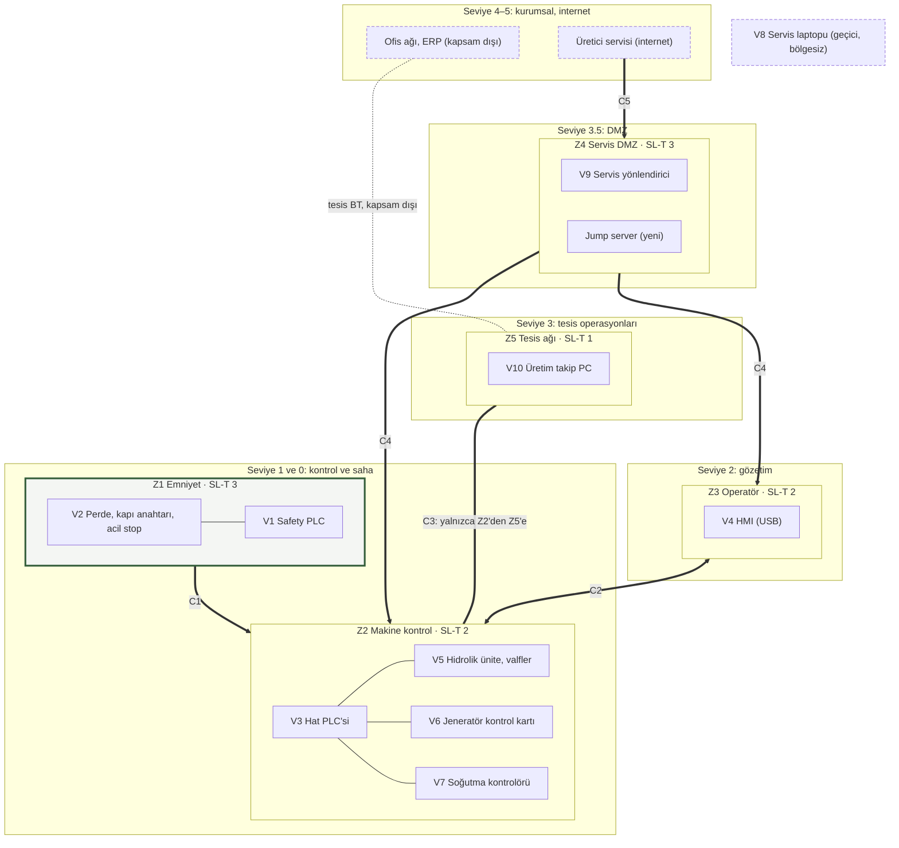

# LABORATUVAR FÖYÜ 2

## IEC 62443'e Göre Bölge ve Geçit Tasarımı

### 2. hafta

| | |
|---|---|
| **Konu alanı** | IEC 62443 · bölge (zone), geçit (conduit) ve hedef güvenlik seviyesi (SL-T) |
| **Makine** | Sonar Elektronik Yüksek Frekans Jeneratörü, 60 kW RF çıkış, 13,56 MHz |
| **Hazırlayan** | Beyza Kuzu |

> Bu belge yapay zekâ asistanı Claude (Anthropic) desteğiyle hazırlanmıştır.

## 1. Amaç

Hafta 1'de tanımlanan bağlı kurulumun dijital varlıkları bu föyde listelenir. Bu varlıklar IEC 62443'teki bölge ve geçit mantığıyla gruplanır ve her bölgeye bir hedef güvenlik seviyesi (SL-T) verilir. Bölgeler arası geçişlerde neyin geçtiği ve hangi kurala bağlı olduğu yazılır. Ayrıca üreticinin uzak servisi için uygulanacak erişim kuralları belirlenir. Temel tasarım kararı, emniyet tarafının (SF-1–SF-4) kendi bölgesinde kalmasıdır.

## 2. Ön bilgi

**Bölge (zone):** güvenlik gereksinimleri aynı olan varlıkların grubu. Bir bölgedeki varlıklara aynı ölçüde güvenilir ve aynı korumalar uygulanır.

**Geçit (conduit):** iki bölge arasındaki iletişim yolu ve bu yol üzerindeki kontroller. Bölgeler arasında tanımlı bir geçit dışında iletişim olmamalıdır.

**Güvenlik seviyesi (SL):** bölgenin hangi saldırgana dayanması gerektiğini anlatır. Bu föydeki yorum:

| SL | Hangi saldırgana karşı |
|---|---|
| SL 1 | Kazara ya da rastlantısal hatalar |
| SL 2 | Basit araçlarla, az kaynakla ve genel bilgiyle yapılan kasıtlı saldırı |
| SL 3 | Endüstriyel sistemlere özgü bilgisi olan, orta kaynaklı ve sofistike araçlar kullanan saldırgan |
| SL 4 | Geniş kaynaklı, sofistike araçlar kullanan saldırgan |

SL-T, bölge için hedeflenen seviyedir.

**Purdue modeli:** varlıkları seviyelere ayırır. Seviye 0 sahadaki sensör ve aktüatörler, Seviye 1 kontrolcüler, Seviye 2 gözetim (HMI), Seviye 3 tesis operasyonları, 3.5 DMZ, 4–5 kurumsal ağ ve internettir.

Hatırlatma: standart jeneratörde PLC, HMI ve uzak erişim yok. Aşağıdaki mimari makine-bilgisi.md'deki VS-4–VS-8 varsayımlarına dayanır.

## 3. Uygulama

### 3.1 Varlık envanteri

**Tablo 1.** Varlık envanteri

| No | Varlık | Ne yapıyor | Kiminle konuşuyor |
|---|---|---|---|
| V1 | Safety PLC | SF-1–SF-4 mantığını çalıştırır, K1/K2 kontaktörlerini ve pres valflerinin enerjisini keser | V2 (kablolu); V3'e yalnızca durum bilgisi (C1) |
| V2 | Emniyet giriş cihazları | İki ışık perdesi, koruyucu kapı anahtarları, kabin kapı kilidi, acil stoplar | V1 (kablolu, OSSD ve kontak) |
| V3 | Hat PLC'si | Pres sırası, RF isteği, reçetenin uygulanması, alarmlar | V4 (Ethernet); V5, V6, V7 (I/O ve Modbus); V10 (OPC UA); V1'den durum okur |
| V4 | HMI paneli | Reçete seçme ve düzenleme, alarm ekranı, kullanıcı girişi; önünde USB portu var | V3 |
| V5 | Hidrolik ünite ve valf blokları (sol, sağ) | Pres kapama, basınç tutma, açma | V3 (dijital I/O); güç kesme V1 üzerinden |
| V6 | Jeneratör kontrol kartı ve anot ayar ünitesi | RF açma-kapama, anot akımı ayarı, aşırı akım koruması | V3 (analog ve dijital I/O); yüksek gerilim beslemesi V1'in kontaktörlerinden geçer |
| V7 | Soğutma ünitesi kontrolörü | Su debisi ve sıcaklığı | V3 (Modbus RTU, varsayım) |
| V8 | Servis / mühendislik laptopu | PLC ve safety PLC programlama, yedek alma | Geçici olarak V3 veya yerinde V1; USB bellek |
| V9 | Uzak servis yönlendiricisi (4G/VPN) | Üreticinin uzaktan bağlanması | İnternet; V3 ve V4 |
| V10 | Üretim takip bilgisayarı | Üretim adedi, duruş nedenleri, reçete arşivi | V3 (OPC UA); ofis ağı |

### 3.2 Bölgeler ve hedef güvenlik seviyeleri

**Tablo 2.** Bölgeler ve SL-T

| Bölge | Varlıklar | SL-T | Neden |
|---|---|---|---|
| Z1 Emniyet | V1, V2 (ve K1/K2) | **3** | Buradaki bir değişiklik doğrudan insana zarar verir. Makineyi bilen, hedefli bir saldırgana dayanmalı. Ağ bağlantısı neredeyse olmadığı için bu hedefe ulaşmak görece kolay |
| Z2 Makine kontrol | V3, V5, V6, V7 | **2** | Kontrolün bozulması kalite kaybı ve duruş demek. Reçete yoluyla aşırı ısınma riski de var (Hafta 1, D5). Hafta 3'ten sonra 3'e çıkarılması önerildi |
| Z3 Operatör | V4 | **2** | Hücreye giren herkesin dokunduğu panel. USB portu fiziksel bir kapı. Z2'den ayrı tutulmasının nedeni insanlar ve taşınabilir bellekler |
| Z4 Servis DMZ | V9, jump server (yeni) | **3** | İnternete açılan tek kapı. Fırsatçı saldırıların ilk denediği yer |
| Z5 Tesis ağı | V10 (ofis ağı kapsam dışı) | **1** | Tesisin BT ekibinin sorumluluğunda. Makine tarafı Z5'i güvenilmez kabul eder, korumalar geçitlerde |

V8 (servis laptopu) hiçbir bölgeye yazılmadı, çünkü sürekli yer değiştiriyor. Nasıl ele alındığı 3.5'te.

Z1'in ayrı bir bölge olması bu tasarımın merkezinde. Safety PLC'nin ağ bağlantısı yalnızca durum bilgisini dışarı vermek için var. Hiçbir bölgeden Z1'e yazma ya da programlama yolu yok.

### 3.3 Bölge ve geçit diyagramı

**Şekil 1.** Purdue seviyelerine göre bölge ve geçit diyagramı. Yeşil çizgiler geçitler (C1–C5), gri kesikli kutular kapsam dışı ya da geçici varlıklar.

### 3.4 Geçitler

**Tablo 3.** Geçitler ve kuralları

| Geçit | Arası | Ne geçiyor | Kural |
|---|---|---|---|
| C1 | Z1 → Z2 | Safety PLC'den hat PLC'sine durum bitleri: SF aktif, reset bekleniyor, kontaktör hatası | Tek yön. Kablolu dijital çıkış ya da salt-okunur haberleşme. Z2'den Z1'e yazma yok. Muting için kullanılan "pres kapalı" sinyali Z2'den değil, Z1'deki emniyetli konum sensöründen gelir (Hafta 1, D3) |
| C2 | Z2 ↔ Z3 | HMI ile PLC arası: reçete yazma, alarm ve durum okuma | Yalnızca HMI'nın adresi ve kullandığı protokol. Reçete değerleri PLC içinde sabit alt ve üst sınırla kontrol edilir, sınır dışı değer reddedilir. HMI'da kişisel kullanıcı ve rol |
| C3 | Z2 → Z5 | Üretim adedi, çevrim süreleri, alarm geçmişi (OPC UA) | Güvenlik duvarı. Veri yalnızca Z2'den dışarı akar. Z5'ten PLC'ye yazma ve programlama portu kapalı |
| C4 | Z4 → Z2 / Z3 | Uzak servis oturumu: HMI ekranı, PLC'nin çevrimiçi izlenmesi, gerekirse program değişikliği | Yalnızca jump server'dan. Yerel onayla açılır. Oturum kaydı tutulur. Z1'e yol yok |
| C5 | İnternet → Z4 | Üreticinin VPN tüneli | Varsayılan kapalı. MFA. Yalnızca tanımlı kişisel hesaplar. Süre sınırlı |

### 3.5 Servis laptopu ve USB için not

Servis laptopu (V8) bir bölgeye ait değil, ama bağlandığı bölgenin bütün haklarını alıyor:

- Mümkünse tesise ait, yalnızca bu makine için kullanılan bir bakım laptopu kullanılmalı. Üretici teknisyeni kendi bilgisayarıyla gelirse, bağlanmadan önce güncel bir taramadan geçirilmeli ve bağlantı yalnızca Z2'deki anahtarlı bakım portundan yapılmalı.
- Safety PLC'ye bağlanmak için ayrı bir port var ve bu port kilitli kabinin içinde. Bu bağlantı yalnızca emniyet doğrulaması yapacak yetkili kişi içindir.
- HMI'nın USB portu normalde kapalı olmalı, fiziksel kilit ya da yazılım ayarıyla. Reçete aktarmak gerekiyorsa yalnızca tesise ait ve taranmış bellek kullanılmalı. HMI'da otomatik çalıştırma kapalı olmalı.
- Proje yedeklerinde parola ya da uzak erişim bilgisi düz metin olarak tutulmamalı (bkz. Hafta 3, R4).

### 3.6 Üretici uzak servisi için erişim kuralları

1. **Varsayılan kapalı.** Servis yönlendiricisinin internet bağlantısı normalde kapalıdır. Vardiya amiri kabin üzerindeki anahtarla açar. Oturum en geç 2 saat sonra kendiliğinden kapanır.
2. **VPN.** Üretici yalnızca şifreli VPN tüneliyle bağlanır. Port yönlendirme yoktur. İnternete açık uzak masaüstü ya da web arayüzü de yoktur.
3. **Jump server.** Tünel Z4'teki ara sunucuda biter. PLC'ye ve HMI'ya yalnızca buradan gidilir. Teknisyenin bilgisayarı makine ağının parçası olmaz.
4. **MFA.** Parolaya ek olarak ikinci bir doğrulama istenir: uygulama kodu ya da donanım anahtarı.
5. **Kişisel hesap.** Her teknisyenin kendi adına bir hesabı olur. "servis" gibi ortak hesap kullanılmaz. Üretici, işten ayrılan teknisyeni bildirir ve hesabı aynı gün kapatılır.
6. **Oturum kaydı.** Jump server ekran ve komut kaydı tutar. PLC'ye yapılan her program yüklemesi kayda geçer. Kayıtlar tesiste saklanır (bu çalışmada 90 gün seçildi, süre işletmenin kararı).
7. **Emniyet tarafına uzaktan erişim yok.** Z1'e giden bir ağ yolu yoktur. Safety PLC programı ve ışık perdesi ayarları yalnızca yerinde, yetkili bir kişi tarafından değiştirilir. Her değişiklikten sonra doğrulama testi yapılır.
8. **Yerel onay.** Program ya da reçete sınırı değişikliği, vardiya amiri HMI'da onaylamadan uygulanmaz. Bu sırada makine güvenli durumdadır: presler açık, RF kapalı.
9. **En az yetki.** Teknisyen oturuma yalnızca okuma yetkisiyle başlar. Yazma yetkisi gerekirse oturum içinde ayrıca açılır.

## 4. Değerlendirme

Emniyet tarafını ayrı bir bölgeye koymak, Z1 için çok sayıda ağ önlemini gereksiz kıldı. Z1'e ağdan ulaşılamıyorsa SL-T 3 hedefi büyük ölçüde fiziksel erişim kontrolüyle karşılanabilir. Ancak bu tasarım, Hafta 1'deki D3 bulgusu çözülmeden işe yaramaz. Muting sinyali normal PLC'den geliyorsa Z1 aslında Z2'ye bağımlıdır. C1'in kuralı bu yüzden yazıldı.

En çok tartışmaya açık karar Z2'nin seviyesi. Z2'deki bir değişiklik emniyet fonksiyonlarını kapatamaz ama reçete üzerinden aşırı ısınmaya ve yangına yol açabilir. SL-T 2 bu föyde ilk karar olarak bırakıldı. Hafta 3'teki R1 senaryosundan sonra 3'e çıkarılması önerildi.

HMI'yı Z2'ye katıp dört bölgeyle çalışmak da mümkündü. Ayrı tutulmasının nedeni, HMI'nın hücredeki herkese açık tek dijital nokta olması ve USB portu taşıması.

**Açık sorular**

1. Z5 için SL-T vermek makine projesinin işi mi, yoksa yalnızca tesis BT'sinin mi?
2. Jump server tesiste mi durmalı, yoksa üreticinin bulut hizmeti mi kullanılmalı? Kayıtların kimde tutulacağı bu karara bağlı.

## 5. Kaynaklar

1. IEC 62443-3-2:2020, Güvenlik riski değerlendirmesi ve sistem tasarımı (bölge ve geçitler).
2. IEC 62443-3-3:2013, Sistem güvenlik gereksinimleri ve güvenlik seviyeleri.
3. IEC 62443-2-4, IACS servis sağlayıcıları için güvenlik programı gereksinimleri.
4. T. J. Williams, "The Purdue Enterprise Reference Architecture", Computers in Industry, 24(2–3), 1994.
5. Hafta 1 föyü (dijital bağımlılıklar D1–D7) ve makine-bilgisi.md (varsayımlar VS-4–VS-8).
