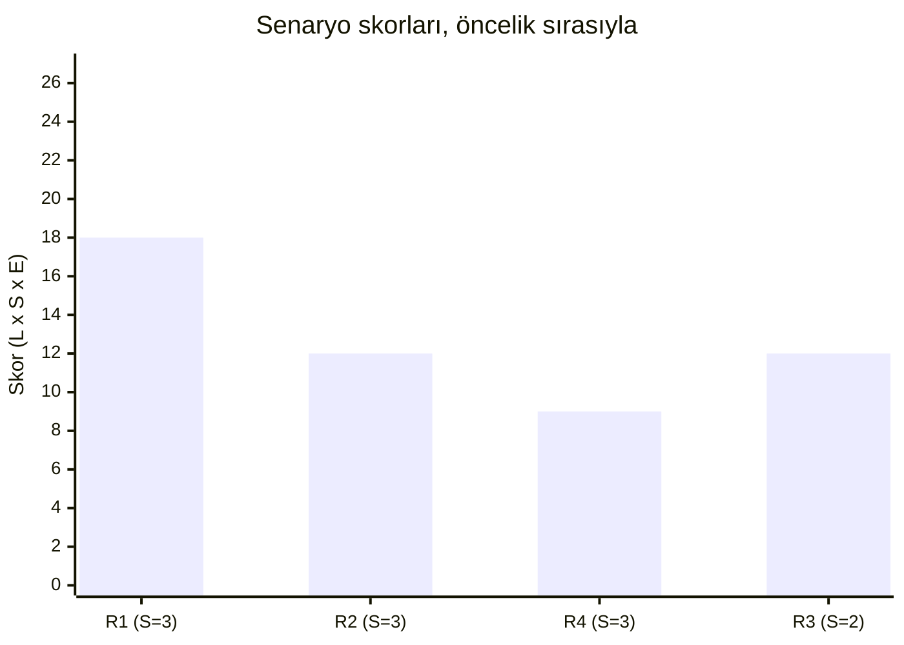

# LABORATUVAR FÖYÜ 3

## Tehdit Senaryoları ve Risk Değerlendirmesi

### 3. hafta

| | |
|---|---|
| **Konu alanı** | Threat & Risk · L×S×E puanlama ve risk matrisi |
| **Makine** | Sonar Elektronik Yüksek Frekans Jeneratörü, 60 kW RF çıkış, 13,56 MHz |
| **Hazırlayan** | Beyza Kuzu |

> Bu belge yapay zekâ asistanı Claude (Anthropic) desteğiyle hazırlanmıştır.

## 1. Amaç

Bu föyde Hafta 2'de belirlenen kapılardan girebilecek tehditler senaryo olarak kurulur. Her senaryo, makinenin başındaki insana ne olduğu sorusuna kadar götürülür. Senaryolar olasılık, şiddet ve maruziyet çarpımıyla (L×S×E) puanlanıp sıralanır. Önerilen önlemler, hangi föyle bağlantılı oldukları belirtilerek listelenir.

## 2. Ön bilgi

Her senaryo beş parçadan oluşur:

1. Kim saldırıyor?
2. Hangi kapıdan giriyor?
3. Ne yapıyor?
4. Hangi olaylar zinciri başlıyor?
5. Fiziksel sonuç ne?

Puanlamada üç parametre 1–3 arasında değer alır.

**Tablo 1.** Puanlama ölçeği

| Puan | L: olasılık | S: şiddet | E: maruziyet |
|---|---|---|---|
| 1 | Zor: özel bilgi, fiziksel erişim ve parola birlikte gerekir | Üretim kaybı, hurda parça, kısa duruş | İnsan nadiren bulunur: bakım, gece, boş hücre |
| 2 | Mümkün: bilinen yöntem, orta beceri | Hafif-orta yaralanma ya da uzun duruş | Vardiya içinde zaman zaman |
| 3 | Kolay: hazır araç, korumasız kapı | Ağır yaralanma (derin yanık, uzuv kaybı), yangın, ölüm | Operatör her çevrimde tehlike bölgesinde |

Skor L × S × E olarak hesaplanır, 1 ile 27 arasında değer alır. Seviyeler için derste verilen eşikler kullanıldı. Küçükten büyüğe: **Düşük 1–3, Orta 4–8, Yüksek 9–17, Kritik 18–27.**

İki kural uygulandı:

- **S = 3 olan senaryo öne alınır.** Skoru düşük olsa bile sıralamada S değeri 3'ten küçük olanların önüne geçer.
- **Zincir veri kaybıyla bitiyorsa devam edilir.** Zincir "veri çalındı" noktasında bitiyorsa, o verinin makinedeki insana nasıl zarar verebileceği sorulur ve zincir oraya kadar uzatılır.

## 3. Uygulama

### 3.1 Saldırı yüzeyi

**Tablo 2.** Saldırı yüzeyi: dört kapı

| Kapı | Nerede | Kim kullanabilir | Hafta 2'deki yeri |
|---|---|---|---|
| G1 Uzak servis yönlendiricisi | Jeneratör kabininde, 4G/VPN | Üretici teknisyeni; parolası ele geçirilirse herkes | Z4, C5 ve C4 |
| G2 HMI ve USB portu | Pres önündeki operatör paneli | Operatör, vardiya amiri, hücreye giren geçici çalışanlar | Z3, C2 |
| G3 Servis / mühendislik laptopu | Bakımda bağlanır | Bakım ekibi, üretici teknisyeni; laptopa bulaşmış zararlı yazılım | V8 (bölgesiz) |
| G4 Tesis ağı bağlantısı | PLC ile üretim takip bilgisayarı arası | Ofis ağındaki herhangi bir bilgisayar, fidye yazılımı | Z5, C3 |

Senaryolarda bazı kapıların "mevcut durumu" anlatılıyor: ortak hesap, MFA yok, düz ağ gibi. Bunlar Hafta 4'te anlatılan mevcut mimari varsayımına dayanıyor.

### 3.2 Senaryo kartları

#### R1 · Çalınan servis hesabıyla reçete değişikliği

| | |
|---|---|
| Kim | Üretici teknisyeninin parolasını oltalama e-postasıyla ele geçiren, endüstriyel sistemlerle uğraşan bir saldırgan |
| Kapı | G1. Mevcut durumda MFA yok ve hesap ortak |
| Ne yapıyor | HMI'ya uzaktan bağlanıyor. Sol presin reçetesinde ısıtma süresini ve anot akımı üst sınırını yükseltiyor |
| Zincir | Reçete PLC'ye yükleniyor → bir sonraki çevrimde tutkal hattına planlanandan fazla enerji gidiyor → nemli lamel ya da fazla tutkal olan noktada ark oluşuyor → kalıp ve kaplama tutuşuyor |
| Fiziksel sonuç | Pres önündeki operatörde yanık ve duman soluma, atölyede talaş ve tutkal kaynaklı yangın. SF-1–SF-4 devreye girmez, çünkü pres kapalı ve koruyucular kapalıyken RF zaten izinli |
| L × S × E | 2 × 3 × 3 = **18 · Kritik** |

#### R2 · Işık perdesinde kalıcı kör nokta

| | |
|---|---|
| Kim | Üretim baskısı altındaki bir bakım çalışanı. Kötü niyetli değil. Kalıp kenarındaki kelepçe perdeyi sık sık kesiyor ve hat duruyor |
| Kapı | G3. Laptopta kayıtlı perde yapılandırma yazılımı ve parolası |
| Ne yapıyor | Perdenin alt kısmına sabit blanking tanımlıyor. Duruşlar bitiyor |
| Zincir | Kör bölge kalıcı hâle geliyor → değişiklik kayda geçmediği için kimse fark etmiyor → aylar sonra yeni bir operatör kalıptaki parçayı düzeltmek için elini o yükseklikten uzatıyor → perde algılamıyor |
| Fiziksel sonuç | Elin ezilmesi ve aynı anda RF verilirse RF yanığı |
| L × S × E | 2 × 3 × 2 = **12 · Yüksek** |

Koruyucuların üretim sürsün diye devre dışı bırakılması iş güvenliğinde bilinen bir sorun. Burada siber bir saldırgan yok, ama kapı (G3) ve yöntem (yapılandırma değişikliği) dijital. E = 2 seçildi, çünkü el her çevrimde kör bölgeden geçmiyor.

#### R3 · Tesis ağından gelen fidye yazılımı

| | |
|---|---|
| Kim | Fidye yazılımı grubu. Makineyle ilgilenmiyor, ofisi hedefliyor |
| Kapı | G4. Mevcut durumda tesis ağı ile makine ağı arasında ayrım yok |
| Ne yapıyor | Ofis ağında yayılan zararlı yazılım Windows tabanlı HMI'ya (varsayım) ve üretim takip bilgisayarına ulaşıp dosyaları şifreliyor |
| Zincir | HMI kilitleniyor → reçete seçilemiyor, alarmlar görülemiyor → hat duruyor → siparişi yetiştirmek için jeneratör yerel panelden, reçete sınırları olmadan elle çalıştırılıyor → süre ve anot ayarı tahminle yapılıyor |
| Fiziksel sonuç | Asıl sonuç günlerce süren duruş. Elle çalıştırmada aşırı ısınma ve hafif yanık olasılığı |
| L × S × E | 3 × 2 × 2 = **12 · Yüksek** |

#### R4 · HMI'dan USB ile proje yedeği kopyalama

| | |
|---|---|
| Kim | Hücreye erişimi olan geçici bir çalışan ya da ziyaretçi teknisyen, üçüncü bir kişi adına |
| Kapı | G2. HMI'nın açık USB portu |
| Ne yapıyor | Reçete dosyalarını, kullanıcı listesini ve proje yedeğini belleğe kopyalıyor |
| Zincir | İlk bakışta "reçete bilgisi çalındı" ile bitiyor. Devamı: proje yedeğinde uzak servis hesabının parolası ve ağ adresleri düz metin duruyor → bu bilgiyle G1'den giriş yapılabiliyor → R1'deki reçete değişikliği artık makineyi tanımayan biri için de kolay |
| Fiziksel sonuç | R1 ile aynı: yangın ve operatör yanığı. Doğrudan değil, iki adımda |
| L × S × E | 1 × 3 × 3 = **9 · Yüksek** |

R4 başta yalnızca bir veri sızıntısı olarak yazılmıştı. Zinciri devam ettirince, çalınan verinin R1'in olasılığını artıran bir anahtar olduğu görüldü. L = 1 seçildi, çünkü iki ayrı adım ve fiziksel erişim gerekiyor.

### 3.3 Olasılık–şiddet matrisi ve skorlar

| S / L | L = 1 (zor) | L = 2 (mümkün) | L = 3 (kolay) |
|---|---|---|---|
| **S = 3 (ağır)**, öne alınır | **R4** · E = 3 · skor 9 | **R1** · E = 3 · skor 18 **R2** · E = 2 · skor 12 | |
| **S = 2 (orta)** | | | **R3** · E = 2 · skor 12 |
| **S = 1 (hafif)** | | | |

**Şekil 1.** Olasılık (L) ve şiddet (S) matrisi. Hücre içindeki etiketler senaryo, E değeri ve skor. Kesikli çerçeve, öne alınma kuralının uygulandığı S = 3 satırı.

**Şekil 2.** Senaryo skorları, öncelik sırasına göre. Arka plandaki bantlar seviye eşikleri. R4'ün skoru R3'ten düşük olduğu hâlde S = 3 olduğu için önce geliyor.

### 3.4 Öncelik tablosu

**Tablo 3.** Öncelik sırası

| Sıra | Senaryo | L × S × E | Skor | Seviye | Not |
|---|---|---|---|---|---|
| 1 | R1 Çalınan servis hesabı | 2 × 3 × 3 | 18 | Kritik | En yüksek skor, S = 3 |
| 2 | R2 Perdede kör nokta | 2 × 3 × 2 | 12 | Yüksek | S = 3 |
| 3 | R4 USB ile yedek kopyalama | 1 × 3 × 3 | 9 | Yüksek | S = 3. R3'ün önüne alındı |
| 4 | R3 Fidye yazılımı | 3 × 2 × 2 | 12 | Yüksek | Skoru R4'ten yüksek, ama S = 2 |

R3'ün en olası senaryo olduğu (L = 3) unutulmamalı. Sıralamada geride kalması önemsiz olduğu anlamına gelmiyor. Önerilen ağ ayrımı (Ö6) zaten R1 ve R4'e karşı alınan önlemlerle birlikte uygulanacak.

### 3.5 Önlem önerileri

**Tablo 4.** Önlemler ve bağlantılı föyler

| No | Önlem | Senaryo | Bağlantılı föy |
|---|---|---|---|
| Ö1 | Uzak serviste MFA, kişisel hesap, varsayılan kapalı erişim ve jump server | R1, R4 | Hafta 2 (erişim kuralları 1–6), Hafta 4 |
| Ö2 | Isıtma süresi ve anot akımı için PLC'de sabit üst sınır; sınır değişikliği yalnızca yerel onayla | R1, R3 | Hafta 1 (D5), Hafta 2 (C2), Hafta 4 (GR-4) |
| Ö3 | Ark ve aşırı ısınmada RF'yi normal PLC'den bağımsız kesen koruma; Hafta 1'deki SF listesine eklenmesi değerlendirilmeli | R1, R3, R4 | Hafta 1 (açık soru 3), Hafta 4 (GR-4) |
| Ö4 | Safety PLC ve ışık perdesi ayarlarının kayıt altına alınması: kontrol toplamı ve parametre listesi, vardiya başında perde testi, değişiklik izni | R2 | Hafta 1 (D1, D2), Hafta 4 (GR-2) |
| Ö5 | Duruşun nedenini gidermek: kelepçe tasarımı ya da perde konumu değiştirilerek perdeyi susturma ihtiyacı ortadan kaldırılır | R2 | Hafta 1 |
| Ö6 | Tesis ağı ile makine arasında güvenlik duvarı; veri yalnızca dışarı akar, HMI ofis ağından görünmez | R3 | Hafta 2 (C3) |
| Ö7 | HMI USB portunun kapatılması; proje yedeklerinde parola tutulmaması | R4 | Hafta 2 (3.5) |
| Ö8 | Z2'nin SL-T değerinin 2'den 3'e çıkarılması | R1, R3 | Hafta 2 |
| Ö9 | HMI olmadan elle çalışma için yazılı prosedür ve sınırlar | R3 | Hafta 1 (işletme talimatı) |

## 4. Değerlendirme

En yüksek öncelikli senaryo R1 çıktı. R1'de saldırgan hiçbir emniyet fonksiyonuna dokunmuyor. Yalnızca reçeteyi değiştiriyor ve sonuç yangın. Hafta 1'deki dört emniyet fonksiyonu pres açılınca ya da biri koruma alanına girince devreye giriyor. Tutkal hattının aşırı ısınmasını ise hiçbiri izlemiyor. Bu yüzden Ö3, bu föyün en önemli çıktısı. Hafta 1'deki ark korumasını SF saymama kararı bu senaryodan sonra zayıf görünüyor.

R2 bir saldırı değil, iyi niyetli bir değişiklik. Ancak etkisi R1 kadar ağır olabilir ve iz bırakmıyor. R4 ise kuralın neden önemli olduğunu gösterdi: zincir veri kaybında bıraksaydı, R4 düşük öncelikli bir gizlilik sorunu olarak kalacaktı.

Puanlar kesin değil. Özellikle E değerleri hücrenin gerçek çalışma düzenine (vardiya sayısı, hücredeki kişi sayısı) bağlı. Bu bilgiler olmadan seçildi.

**Açık sorular**

1. R2'deki gibi saldırgansız ama dijital yoldan yapılan değişiklikler siber risk kaydına mı, yoksa iş güvenliği risk değerlendirmesine mi yazılmalı?
2. E değerini senaryonun ilk adımı mı, yoksa fiziksel sonucun gerçekleştiği an mı belirlemeli? R4'te bu ikisi farklı.

## 5. Kaynaklar

1. IEC 62443-3-2:2020, Güvenlik riski değerlendirmesi ve sistem tasarımı.
2. ISO 12100:2010, Risk değerlendirmesi ve risk azaltma.
3. MITRE ATT&CK for ICS bilgi tabanı, attack.mitre.org (senaryoların kurgusunda teknik listesi olarak kullanıldı).
4. Hafta 1 föyü (SF-1–SF-4, D1–D7) ve Hafta 2 föyü (bölgeler, geçitler, erişim kuralları).
5. makine-bilgisi.md: varsayımlar.
