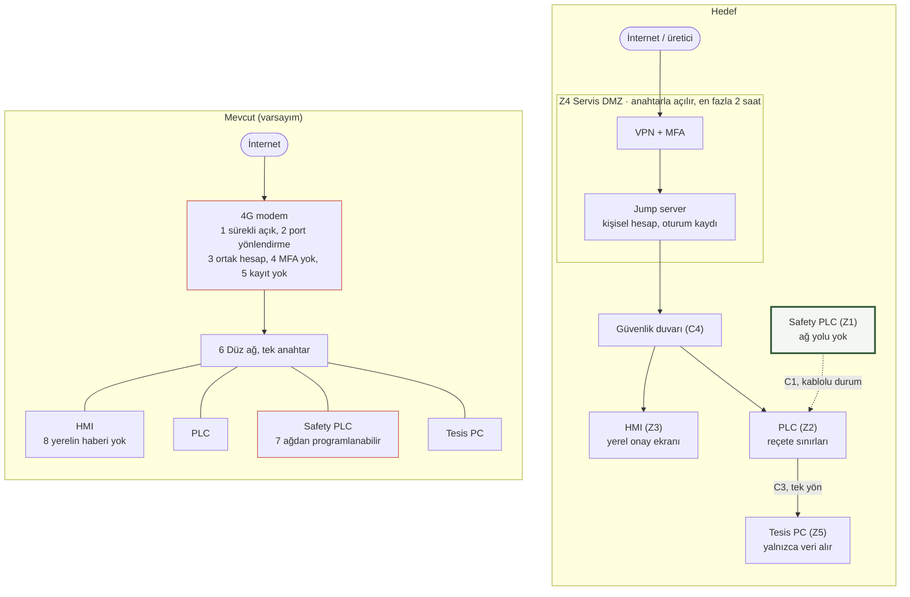
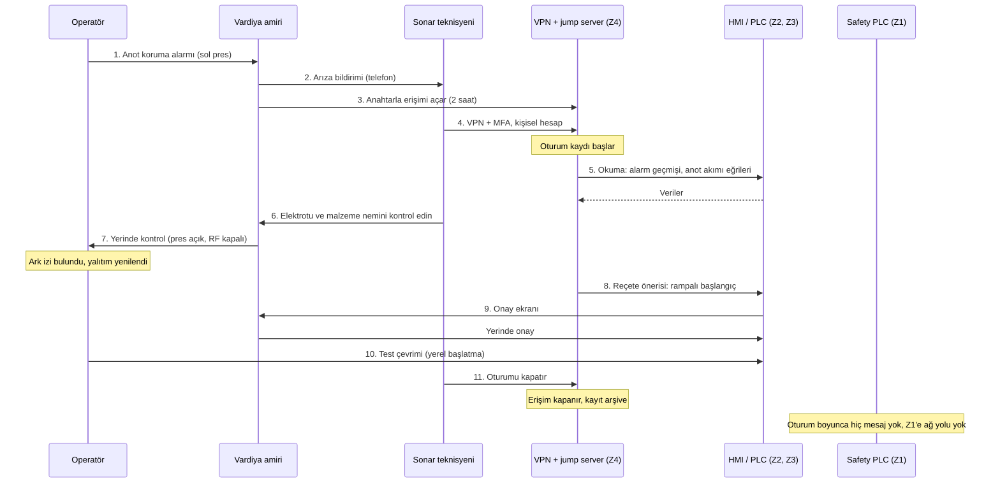

# LABORATUVAR FÖYÜ 4

## Güvenli Uzak Servis Erişimi

### 4. hafta

| | |
|---|---|
| **Konu alanı** | Secure Remote Access · erişim güvenliği ve emniyet bağımsızlığı |
| **Makine** | Sonar Elektronik Yüksek Frekans Jeneratörü, 60 kW RF çıkış, 13,56 MHz |
| **Hazırlayan** | Beyza Kuzu |

> Bu belge yapay zekâ asistanı Claude (Anthropic) desteğiyle hazırlanmıştır.

## 1. Amaç

Bu föyde üreticinin uzaktan arıza tespiti yapabilmesi için gereken erişim tasarlanır. Tasarım Hafta 2'deki kurallara ve Hafta 3'teki senaryolara dayanır. Önce varsayılan mevcut mimarinin zayıflıkları listelenir, sonra hedef mimari çizilir. Somut bir arıza üzerinden örnek bir servis oturumu adım adım anlatılır. Son olarak, biri içeri girse bile emniyet fonksiyonlarının etkilenmemesi için gereken şartlar gereksinim olarak yazılır.

## 2. Ön bilgi

Bu makinede uzak erişim ihtiyacı gerçek bir ihtiyaç. Triyot lambanın yaşlanması anot ve grid akımlarına yansır ve bu eğrileri okumak deneyim ister. Yeni bir ürüne geçerken ısıtma süresi ve anot ayarı da üretici desteğiyle bulunur. Üretici İzmir'de ve makineleri ihraç ediyor. Her arızada teknisyen göndermek pahalı ve yavaş.

Uzak erişimde iki ayrı soru var:

1. **Erişim güvenliği:** içeri girmek ne kadar zor?
2. **Emniyetin bağımsızlığı:** biri yine de içeri girerse, insan korunmaya devam ediyor mu?

Bu föy ikisini ayrı ayrı ele alıyor.

Hatırlatma: standart jeneratörde uzak erişim görünmüyor. Aşağıdaki "mevcut" mimari, sahada sık görülen aceleyle kurulmuş bir modem bağlantısı örnek alınarak varsayıldı. Sonar'ın gerçek uygulaması bilinmiyor.

## 3. Uygulama

### 3.1 Mevcut ve hedef mimari

**Şekil 1.** Solda varsayılan mevcut mimari (kırmızı numaralar 3.2'deki zayıflıklar), sağda hedef mimari.

### 3.2 Zayıflıklar

Mevcut mimarideki zayıflıklar:

1. Modem sürekli açık ve internetten erişilebilir.
2. Port yönlendirme ile HMI'nın uzak masaüstü ve PLC'nin programlama portu doğrudan internete açık.
3. Tek bir ortak hesap var ("servis"). Parolası yıllardır aynı ve birçok teknisyen biliyor.
4. MFA yok.
5. Oturum kaydı yok. Kimin ne zaman bağlandığı ve neyi değiştirdiği bilinmiyor.
6. Ağ düz. Modem, HMI, PLC, safety PLC ve tesis bağlantısı aynı anahtara (switch) bağlı.
7. Safety PLC ağ üzerinden programlanabiliyor.
8. Uzak bağlantı başladığında makinenin başındaki kimsenin haberi olmuyor. Makine çalışırken değişiklik yapılabiliyor.

Hafta 3'teki R1 bu listedeki 1, 3, 4 ve 5'ten yararlanıyor. R3'ün kapısı 6. R4'te çalınan parolanın işe yaraması 3 ve 4'e bağlı.

### 3.3 İlkeler ve bu makinedeki karşılıkları

**Tablo 1.** İlke ve karşılığı

| İlke | Bu makinedeki karşılığı | Kapattığı zayıflık |
|---|---|---|
| Varsayılan kapalı | Kabin üzerinde anahtarlı servis şalteri; oturum en fazla 2 saat | 1, 8 |
| Şifreli tünel | Port yönlendirme kaldırılır, yalnızca VPN | 2 |
| Ara nokta | Z4'te jump server. Teknisyen PLC'ye değil sunucuya bağlanır | 2, 6 |
| Güçlü kimlik doğrulama | VPN girişinde MFA | 4 |
| Kişisel hesap | Her teknisyen için ayrı hesap; ayrılanın hesabı aynı gün kapanır | 3 |
| Kayıt | Jump server'da ekran ve komut kaydı; PLC'ye yüklemeler ayrıca loglanır | 5 |
| En az yetki | Oturum okuma yetkisiyle başlar; yazma ayrıca açılır | 2, 8 |
| Yerel kontrol | Program ve reçete sınırı değişiklikleri HMI'da vardiya amiri onayına bağlı; RF ve pres hareketi uzaktan başlatılamaz | 8 |
| Ağ ayrımı | Bölgeler arasında güvenlik duvarı; tesis ağına veri yalnızca dışarı akar | 6 |
| Emniyet bağımsızlığı | Safety PLC'nin ağ yolu yok; durum bilgisi kablolu (C1) | 7 |

### 3.4 Örnek servis oturumu

**Arıza.** Sol preste RF verildikten birkaç saniye sonra "anot koruma" lambası yanıyor ve RF kesiliyor. Sağ pres normal çalışıyor. Arıza üç vardiyadır tekrarlıyor.

**Şekil 2.** Örnek servis oturumunun sıra diyagramı. Numaralar aşağıdaki adımlarla aynı. Safety PLC oturum boyunca hiçbir mesaj almıyor.

1. Operatör alarmı görür ve vardiya amirine bildirir. Pres açık, RF kapalı.
2. Vardiya amiri Sonar servisini arar. Arıza kaydı açılır ve bağlanacak teknisyenin adı alınır.
3. Vardiya amiri kabindeki anahtarla servis erişimini açar. Erişim 2 saat sonra kendiliğinden kapanacak.
4. Teknisyen VPN'e bağlanır, MFA onayını verir ve jump server'a kendi hesabıyla girer. Oturum kaydı başlar.
5. Teknisyen okuma yetkisiyle PLC'deki alarm geçmişine ve son çevrimlerin anot akımı eğrilerine bakar. Akımın ısıtmanın birkaç saniyesinde sıçradığını görür. Reçetede değişiklik yok.
6. Teknisyen sorunun kalıpta olduğundan şüphelenir. Vardiya amirinden üst elektrotun yalıtımını ve malzeme nemini kontrol etmesini ister.
7. Pres açık ve RF kapalıyken bakımcı üst elektrotun kenarında bir ark izi bulur ve yalıtımı yeniler.
8. Teknisyen, nemli parti için ısıtmanın düşük güçle başlamasını (rampa) önerir ve reçete değişikliğini hazırlar.
9. Değişiklik HMI'da vardiya amirinin onay ekranına düşer. Amir yerinde onaylar. Değer PLC'deki sınırlar içinde olduğu için kabul edilir.
10. Operatör test çevrimini yerelde başlatır ve alarm tekrarlamaz. Uzaktan başlatma mümkün değil.
11. Teknisyen oturumu kapatır. Erişim kapanır, kayıt arşivlenir ve arıza kaydına işlenir.

Oturum boyunca teknisyen safety PLC'ye hiç ulaşmadı, ulaşması da gerekmedi. Arıza emniyetle ilgili olsaydı (örneğin ışık perdesi arızası) uzaktan yalnızca teşhis yapılabilirdi. Onarım ve doğrulama yerinde yapılmalıydı.

### 3.5 İçeri sızan biri emniyet fonksiyonlarını bozabilir mi?

**Mevcut mimaride: evet.** Safety PLC ağa bağlı ve programlanabilir (zayıflık 7). Ağa giren biri SF-1–SF-4'ün mantığını değiştirebilir. Ayrıca Hafta 1'deki D3 bulgusuna göre muting sinyali normal PLC'den geliyor. Bu yüzden safety PLC'ye hiç dokunmadan, yalnızca normal PLC üzerinden SF-1 ve SF-2 susturulabilir.

**Hedef mimaride: emniyet fonksiyonları etkilenmez, ama insan yine de zarar görebilir.** Z1'e ağ yolu yok ve muting sinyali emniyetli sensörden geliyor. Saldırgan Z2'ye ya da Z3'e ulaşsa bile SF'leri kapatamaz. Ancak Hafta 3'teki R1, SF'lere dokunmadan reçete üzerinden yangına gidiyor. "Emniyet fonksiyonu etkilenmez" cevabı doğru ama eksik. İnsanı bu yoldan da korumak için GR-4 eklendi.

### 3.6 Emniyet bağımsızlığı gereksinimleri

Aşağıdakiler çözüm değil, gereksinimdir. Bunların nasıl karşılanacağı (ayrı emniyet rölesi, donanım zamanlayıcı, kablolu sinyal vb.) tasarım kararıdır ve bu föyün konusu değildir.

**Tablo 2.** Emniyet bağımsızlığı gereksinimleri

| No | Gereksinim | Nasıl doğrulanır |
|---|---|---|
| GR-1 | SF-1–SF-4, normal PLC, HMI ve bütün ağ bağlantıları kapalıyken bile tasarlandığı gibi çalışmalıdır. | Normal PLC'nin enerjisi kesilir ve ağ kabloları çıkarılır. Her SF tek tek tetiklenir. K1/K2'nin açıldığı ve pres hareketinin durduğu ölçülür, tepki süreleri kaydedilir. |
| GR-2 | Safety PLC programı, parametreleri ve ışık perdesi ayarları ağ üzerinden değiştirilememelidir. Değişiklik yalnızca yerinde ve yetkili kişiyle yapılmalı, her değişiklikten sonra emniyet doğrulaması tekrarlanmalıdır. | Jump server'dan ve tesis ağından safety PLC'ye bağlantı denenir ve kurulamaması gerekir. Safety PLC'nin kontrol toplamı devreye alma kaydındaki değerle karşılaştırılır. |
| GR-3 | Z2'den gelen hiçbir sinyal bir emniyet fonksiyonunu devre dışı bırakamamalı, susturamamalı ya da resetleyememelidir. Muting ve reset sinyalleri emniyet sınıfı cihazlardan gelmelidir. | Normal PLC'de muting ve reset bitleri zorlanır (force). SF'lerin etkilenmediği gözlenir. Devre şeması üzerinden her emniyet girişinin kaynağı tek tek kontrol edilir. |
| GR-4 | Tutkal hattının aşırı ısınmasına ve elektrotlar arası arka karşı RF'yi kesen koruma, reçeteden ve normal PLC'den bağımsız olmalıdır. Isıtma süresi ve anot akımı için reçeteyle aşılamayan üst sınırlar bulunmalıdır. | HMI'dan sınırın üstünde bir değer girilir ve kabul edilmemesi gerekir. Üreticiyle birlikte yapılan kontrollü bir ark testinde, normal PLC devre dışıyken RF'nin kesildiği gösterilir. |
| GR-5 | RF başlatma, pres kapatma ve emniyet resetleme uzaktan yapılamamalıdır. Bu komutlar yalnızca makinenin başındaki kumanda elemanlarından verilebilmelidir. | Bir uzak oturum sırasında bu komutlar jump server'dan denenir. Çalışmadıkları ve denemelerin oturum kaydında göründüğü kontrol edilir. |

## 4. Değerlendirme

Dört föy tek bir zincir oluşturuyor:

**Tablo 3.** Haftalar arası bağlantı

| Hafta | Çıktı | Sonraki haftada nasıl kullanıldı |
|---|---|---|
| 1 | SF-1–SF-4, PLr değerleri, dijital bağımlılıklar D1–D7 | D1–D3, Z1'in sınırını ve C1 kuralını belirledi. D5 Hafta 3'te R1'in temeli oldu |
| 2 | Bölgeler Z1–Z5, geçitler C1–C5, erişim kuralları | Kapılar G1–G4 bu bölgelerden çıkarıldı. Erişim kuralları Hafta 4'teki hedef mimarinin iskeleti oldu |
| 3 | R1–R4, öncelik sırası, önlemler Ö1–Ö9 | R1 ve R4, uzak erişim tasarımının neden gerekli olduğunu gösterdi. Ö3, GR-4'e dönüştü |
| 4 | Hedef mimari, örnek oturum, GR-1–GR-5 | GR-4, Hafta 1'deki SF listesinin yeniden açılması gerektiğini gösteriyor |

Hafta 1'de emniyet fonksiyonları yalnızca "insan koruma alanına girerse" durumu için tanımlandı. Dördüncü haftanın sonunda görülen şu oldu: bu makinede insana zarar verebilecek ikinci bir yol var. O da sürecin kendisi, yani fazla enerji, ark ve yangın. Uzak erişim güvenliği bu yolun olasılığını düşürüyor (R1'de L değeri). Şiddetini ise düşürmüyor. Şiddeti düşüren tek şey GR-4. Bu yüzden bir sonraki adım, Hafta 1'deki listeye "aşırı ısınma ve arkta RF'nin kesilmesi" adında beşinci bir emniyet fonksiyonu eklemek ve onun PLr'sini belirlemek olmalı.

Bir sınırlılık: bütün bu tasarım, standart makinede olmayan bir dijital mimari üzerine kuruldu. Gerçek bir kurulumda ilk iş, Sonar'ın sunduğu bağlantı seçeneklerini ve emniyet donanımını üreticiden yazılı olarak öğrenmek olur.

**Açık sorular**

1. GR-4 için gereken koruma bir emniyet fonksiyonu mu, yoksa bir proses koruması mı? PLr belirlenecekse S, F, P nasıl seçilmeli?
2. 2023/1230 Ek III'teki 1.2.1 (f) maddesi, emniyet yazılımına yapılan müdahalelerin kaydının beş yıl tutulmasını istiyor. Jump server kayıtları bu amaçla kullanılabilir mi, yoksa kaydın makinenin kendisinde mi tutulması gerekir?

## 5. Kaynaklar

1. IEC 62443-3-3:2013, özellikle SR 1.13 (güvenilmeyen ağlar üzerinden erişim) ve SR 2.6 (uzak oturumun sonlandırılması).
2. IEC 62443-2-4, IACS servis sağlayıcıları için gereksinimler.
3. Makine Yönetmeliği (AB) 2023/1230, Ek III, 1.1.9 (bozulmaya karşı koruma) ve 1.2.1 (kontrol sistemlerinin güvenliği ve güvenilirliği). Uygulama tarihi 20 Ocak 2027 (OJ L 169, 4.7.2023 düzeltmesiyle).
4. ISO 13849-1:2023 ve ISO 13849-2:2012 (doğrulama).
5. Hafta 1, 2 ve 3 föyleri; makine-bilgisi.md.
