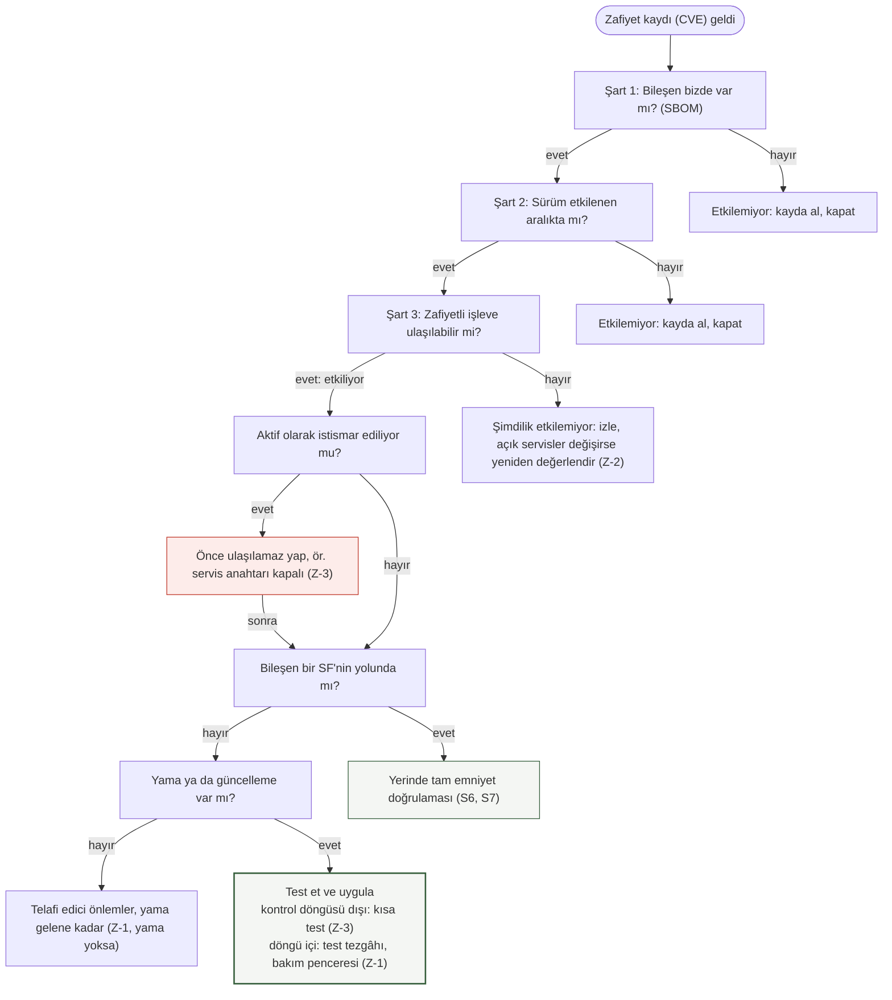
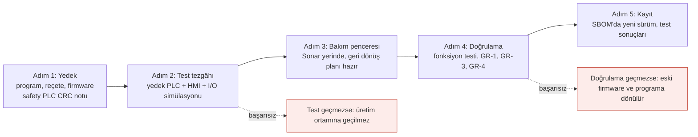

# LABORATUVAR FÖYÜ 5

## Yazılım Bileşenleri, Zafiyetler ve Yama Kararı

### 5. hafta

| | |
|---|---|
| **Konu alanı** | SBOM / CVE / Patch · zafiyetin bu makineyi gerçekten etkileyip etkilemediği |
| **Makine** | Sonar Elektronik Yüksek Frekans Jeneratörü, 60 kW RF çıkış, 13,56 MHz |
| **Hazırlayan** | Beyza Kuzu |

> Bu belge yapay zekâ asistanı Claude (Anthropic) desteğiyle hazırlanmıştır.

## 1. Amaç

Bu föyde Hafta 2'de tanımlanan bağlı kurulumun yazılım bileşenleri, bir yazılım malzeme listesi (SBOM) olarak çıkarılır. Ardından üç kurgusal zafiyet kaydı, makineyi gerçekten etkileyip etkilemediklerine göre ayrılır. Etkileyen kayıtlar için şu kararlar gerekçelendirilir: üretim durur mu, yama nasıl ve nerede test edilir, emniyet doğrulaması tekrarlanmalı mı. Son olarak yama yapılamayan durum için telafi edici önlemler yazılır.

## 2. Ön bilgi

**SBOM:** bir ürünün içindeki yazılım bileşenlerinin, sürümlerinin ve tedarikçilerinin listesi. Zafiyet haberi geldiğinde "bu bileşen bizde var mı?" sorusuna dakikalar içinde cevap verebilmek için tutulur. CRA, Ek I Bölüm II madde 1'de üreticiden en az üst düzey bağımlılıkları kapsayan, makinece okunabilir bir SBOM istiyor.

**CVE ve CVSS:** CVE, kamuya açıklanmış bir zafiyetin kimlik numarasıdır. CVSS, zafiyetin genel ciddiyetini 0–10 arasında puanlar. CVSS zafiyetin kendisini anlatır, bu makinedeki riski anlatmaz. Örneğin internetten ulaşılamayan bir bileşendeki 9,8 puanlı açık, servis anahtarı açıkken internete bakan bir bileşendeki 7 puanlı açıktan daha az acil olabilir.

Bir zafiyetin bu makineyi etkilemesi için üç şartın birlikte sağlanması gerekiyor:

**Tablo 1.** Etki için üç şart

| Şart | Soru | Nereden bakılır |
|---|---|---|
| 1. Bileşen | Zafiyetli bileşen bizim kurulumda var mı? | SBOM (Tablo 2) |
| 2. Sürüm | Bizdeki sürüm etkilenen sürüm aralığında mı? | SBOM ve üreticinin güvenlik duyurusu |
| 3. Ulaşılabilirlik | Zafiyetli işleve bir saldırgan ulaşabilir mi? | Hafta 2'deki bölgeler ve geçitler, cihazın açık servisleri |

**Önemli not:** Makinenin gerçek yazılım içeriği bilinmiyor. Aşağıdaki bileşen adları, sürümler ve üç zafiyet kaydı **kurgusal** (makine-bilgisi.md, VS-11). Gerçek bir CVE numarası kullanılmadı, kayıtlar "Z-1", "Z-2", "Z-3" diye adlandırıldı.

## 3. Uygulama

### 3.1 Yazılım malzeme listesi

**Tablo 2.** Bağlı kurulumun SBOM'u (varsayım)

| No | Bileşen | Varlık / bölge | Sürüm (örnek) | Tedarikçi | Ağa açıklık |
|---|---|---|---|---|---|
| S1 | Hat PLC'si firmware'i | V3 / Z2 | 3.2.1 | PLC üreticisi | Z2 içi; C2, C3, C4 üzerinden |
| S2 | PLC'ye gömülü OPC UA sunucu kütüphanesi | V3 / Z2 | 1.4.0 | Açık kaynak, PLC firmware'i içinde | C3 (V10 bağlanır), C4 |
| S3 | PLC tanılama web sunucusu | V3 / Z2 | firmware ile gelir | PLC üreticisi | Devreye almada kapatıldı |
| S4 | HMI işletim sistemi (gömülü Windows tabanlı) | V4 / Z3 | örnek sürüm | İşletim sistemi üreticisi | C2, C4; USB portu |
| S5 | HMI çalışma zamanı yazılımı | V4 / Z3 | 16.0 | HMI üreticisi | C2, C4 |
| S6 | Safety PLC firmware'i | V1 / Z1 | 2.1.0 | Safety PLC üreticisi | Ağ yolu yok; kilitli kabinde servis portu |
| S7 | Işık perdesi firmware'i | V2 / Z1 | 1.3 | Sensör üreticisi | Ağ yok; yapılandırma portu |
| S8 | Servis yönlendiricisi firmware'i (VPN dahil) | V9 / Z4 | 7.2.3 | Ağ cihazı üreticisi | İnternet (C5), yalnızca anahtar açıkken |
| S9 | Jump server işletim sistemi ve uzak bağlantı ağ geçidi | Z4 | örnek sürüm | İşletim sistemi ve yazılım üreticileri | C5 tüneli, C4 |
| S10 | Jeneratör kontrol kartı yazılımı (aşırı akım koruması dahil) | V6 / Z2 | bilinmiyor | Sonar (varsayım) | Yalnızca V3 ile I/O |

S10 için tedarikçi Sonar, ama içinde başka bileşenler olup olmadığı bilinmiyor. Gerçek bir kurulumda bu tablonun Sonar'dan ve PLC/HMI üreticilerinden alınması gerekir.

### 3.2 Zafiyet kayıtları ve üç şart

**Tablo 3.** Kurgusal zafiyet kayıtları

| Kayıt | Bileşen | Etkilenen sürümler | Zafiyet | CVSS | Yama | Aktif istismar |
|---|---|---|---|---|---|---|
| Z-1 | S2 OPC UA kütüphanesi | 1.4.0–1.4.2 | Kimlik doğrulamasız bellek taşması; uzaktan kod çalıştırma ya da PLC'nin durması | 8,1 Yüksek | PLC firmware 3.2.4 içinde | Bildirilmedi |
| Z-2 | S3 PLC web sunucusu | Firmware 3.x | Hazırlanmış istekle PLC'nin yeniden başlaması | 7,5 Yüksek | Henüz yok | Bildirilmedi |
| Z-3 | S8 servis yönlendiricisi | 7.0–7.2.4 | VPN girişinde kimlik doğrulamanın atlatılması | 9,8 Kritik | 7.2.5 | Evet, istismar edildiği duyuruldu |

**Tablo 4.** Üç şartın kontrolü

| Kayıt | Bileşen var mı? | Sürüm etkileniyor mu? | Ulaşılabilir mi? | Sonuç |
|---|---|---|---|---|
| Z-1 | Evet (S2) | Evet (1.4.0) | Kısmen. OPC UA sunucusu PLC'de dinliyor; V10 bağlantıyı Z5'ten başlatıyor. Servis oturumunda Z4'ten de ulaşılabiliyor | **Etkiliyor**, ulaşılabilirlik dar |
| Z-2 | Evet (S3) | Evet | Hayır. Web sunucusu devreye almada kapatıldı, port taramasında kapalı görünüyor | **Şu an etkilemiyor**. Web sunucusu açılırsa yeniden değerlendirilir |
| Z-3 | Evet (S8) | Evet (7.2.3) | Evet, ama yalnızca servis anahtarı açıkken ve internetten | **Etkiliyor**, aktif istismar var |

Z-1'in ulaşılabilirlik kontrolü Hafta 2'deki bir eksikliği ortaya çıkardı. C3 kuralı "veri yalnızca Z2'den dışarı akar" diyordu. Ancak OPC UA'da bağlantıyı istemci başlatır ve istemci Z5'teki V10. Yani veri dışarı akıyor, ama bağlantı içeri doğru açılıyor. Kural veri yönünü tarif ediyor, bağlantı yönünü değil. Bu durum aşağıdaki telafi edici önlemlerde ele alındı.

### 3.3 Karar akışı

**Şekil 1.** Zafiyet kaydından karara giden akış. Parantez içindeki etiketler üç kaydın hangi yoldan geçtiğini gösteriyor.

### 3.4 Üretim durur mu?

- **Z-3:** Hayır. Servis anahtarı kapalıyken yönlendiricinin internet bağlantısı yok ve zafiyetli VPN girişine ulaşılamıyor. Yama gelene kadar anahtar kapalı kalır ve uzak servis verilmez. Acil bir arıza olursa Sonar teknisyeni yerinde çalışır.
- **Z-1:** Hayır, ama koşullu. Zafiyeti kullanmak için önce V10'un ya da bir servis oturumunun ele geçirilmesi gerekiyor. Bu, L değerini düşürüyor. Öte yandan PLC'de kod çalıştırabilen biri ısıtma süresini değiştirebilir. Bu, Hafta 3'teki R1'in yangınla biten zinciri. Bu yüzden aşağıdaki durumlardan biri görülürse sol ve sağ pres durdurulur:
  - PLC'nin açıklanamayan biçimde durması ya da yeniden başlaması
  - V10 dışından OPC UA bağlantı denemesi
  - Reçete sınırlarında onaysız değişiklik
- **Z-2:** Hayır. Ulaşılamayan bir işlevdeki zafiyet. Kayıt altına alınır ve web sunucusunun kapalı kaldığı her bakımda kontrol edilir.

### 3.5 Yama doğrudan mı uygulanır, önce test mi edilir?

- **Z-3 (yönlendirici):** Yönlendirici kontrol döngüsünün içinde değil. Üreticinin test ettiği güncelleme birkaç gün içinde uygulanabilir. Önce yedek bir cihazda ya da üreticinin notlarında VPN ve MFA davranışı kontrol edilir. Sonra bağlantı, MFA ve oturum kaydı test edilir.
- **Z-1 (PLC firmware'i):** Doğrudan uygulanmaz. Güncelleme hat PLC'sinin bütün davranışını değiştirebilir. Test sırası aşağıda (Şekil 2).

**Şekil 2.** Z-1 için önerilen yama yolu. Üretim ortamına ancak test tezgâhındaki kontroller geçildikten sonra geçiliyor.

1. Mevcut PLC programının, reçete veritabanının ve firmware sürümünün yedeği alınır. Safety PLC'nin kontrol toplamı not edilir.
2. Test tezgâhında güncelleme yapılır. Tezgâh yedek bir PLC, HMI ve I/O simülasyonundan oluşur; Sonar'da ya da tesiste kurulabilir. Kontrol edilenler: programın yüklenmesi, reçete sınırları, RF isteğinin zamanlaması, alarmlar, OPC UA veri akışı.
3. Planlı bakım penceresinde, Sonar teknisyeni yerindeyken üretim PLC'si güncellenir. Geri dönüş planı hazırdır: eski firmware ve program.
4. Güncellemeden sonra fonksiyon testi ve emniyet bağımsızlığı testleri yapılır: Hafta 4'teki GR-1, GR-3 ve GR-4.
5. Yeni firmware sürümü SBOM'a, test sonuçları bakım kaydına işlenir.

### 3.6 Yama emniyet doğrulamasını etkiliyor mu?

Bunu anlamanın yolu, güncellenen bileşenin bir emniyet fonksiyonunun sinyal yolunda olup olmadığına bakmak. Hafta 1'deki Tablo 6 (D1–D7) bu iş için kullanıldı.

**Tablo 5.** Güncelleme ile emniyet doğrulaması arasındaki ilişki

| Bileşen | SF yolunda mı? | Güncellemeden sonra yapılacak |
|---|---|---|
| S1, S2 hat PLC'si | Hayır, GR-1 ve GR-3 sağlanmışsa. Muting sinyali PLC'den geçiyorsa evet (D3) | Fonksiyon testi; PLC kapalıyken SF'lerin çalıştığının gösterilmesi (GR-1); reçete sınırı testi (GR-4) |
| S4, S5 HMI | Hayır | Fonksiyon testi; yerel onay ekranının çalıştığının kontrolü |
| S6 safety PLC firmware'i | Evet | Tam emniyet doğrulaması: SF-1–SF-4 tetikleme testleri, tepki süreleri, yeni kontrol toplamının kaydı. Yalnızca üreticinin emniyet açısından onayladığı firmware kullanılır |
| S7 ışık perdesi firmware'i | Evet | Test çubuğuyla algılama testi, tepki süresi ve güvenlik mesafesinin yeniden kontrolü |
| S8, S9 yönlendirici ve jump server | Hayır | Bağlantı, MFA ve oturum kaydı testi |
| S10 jeneratör kontrol kartı | Kısmen. Aşırı akım koruması ark ve yangın için önemli (D6) | Üreticiyle birlikte aşırı akım koruma testi |

Z-1'de güncellenen bileşen S2 ve S1. GR-1 ve GR-3 sağlanmışsa tam emniyet doğrulaması gerekmez. Ancak üç test tekrarlanır: GR-1 (PLC kapalıyken SF'ler), GR-3 (PLC'den muting ve reset zorlanması) ve GR-4 (reçete sınırı). Bu testler, güncellemenin emniyet yoluna sızmadığını gösteriyor.

CRA Ek I Bölüm II madde 2, güvenlik güncellemelerinin teknik olarak mümkün olduğunda işlevsel güncellemelerden ayrı sağlanmasını istiyor. Bu makine açısından önemli: yalnızca güvenlik düzeltmesi içeren bir firmware, işlevi de değiştiren bir firmware'e göre çok daha az test gerektirir.

### 3.7 Yama yapılamazsa telafi edici önlemler

Varsayım: Sonar, bu PLC modelinin üretimden kalktığını ve 3.2.4 güncellemesinin bu donanıma gelmeyeceğini bildiriyor.

**Tablo 6.** Z-1 için telafi edici önlemler

| No | Önlem | Neyi azaltır | Bağlantılı föy |
|---|---|---|---|
| T-1 | OPC UA sunucusunu kapatmak; veriyi PLC'nin kendisinin gönderdiği bir yapıya ya da Z4 benzeri ayrı bir veri ağ geçidine taşımak. Böylece Z5'ten PLC'ye bağlantı tamamen kalkar | L (ulaşılabilirlik) | Hafta 2 (C3) |
| T-2 | Geçiş tamamlanana kadar güvenlik duvarında OPC UA'ya yalnızca V10'un adresinden izin vermek | L | Hafta 2 (C3) |
| T-3 | Z2'de pasif ağ izleme: yeni cihaz, yeni bağlantı, PLC'ye program yüklemesi gibi olaylarda alarm | L, tespit süresi | Hafta 4 (kayıt ilkesi) |
| T-4 | V10'un sertleştirilmesi ve güncel tutulması, çünkü Z-1'e giden yol V10'dan geçiyor | L | Hafta 3 (R3) |
| T-5 | Reçete sınırlarının kontrol toplamını HMI'da göstermek; değişiklikte alarm | Tespit süresi | Hafta 1 (D5) |
| T-6 | Reçeteden bağımsız aşırı ısınma ve ark koruması (GR-4). PLC ele geçirilse bile yangına giden yolu keser | S | Hafta 4 (GR-4) |
| T-7 | PLC'nin değiştirilmesinin (modernizasyon) planlanması | Kalıcı çözüm | SWOT (WO) |

Bu listede S değerini düşüren tek önlem T-6. Diğerleri saldırının olasılığını azaltıyor ya da daha erken fark edilmesini sağlıyor.

## 4. Değerlendirme

En kolay karar CVSS puanı en yüksek olan Z-3 için verildi. Yönlendirici emniyet ve kontrol yolunun dışında. Varsayılan kapalı ilkesi sayesinde yama gelene kadar ulaşılamaz durumda tutulabildi. En zor karar ise puanı daha düşük olan Z-1 içindi. Zafiyetli bileşen kontrol döngüsünün içinde, güncellemesi test gerektiriyor ve bozulduğunda Hafta 3'teki yangın zincirine bağlanabiliyor.

Üç şart kontrolü Hafta 2'deki C3 kuralının eksik yazıldığını gösterdi. Bir bölge sınırında yalnızca verinin yönü değil, bağlantıyı kimin başlattığı da tanımlanmalı.

SBOM'un kendisi de bir varsayım. Gerçek bir kurulumda bu föyün ilk adımı Sonar'dan ve bileşen üreticilerinden SBOM istemek olurdu. CRA, 11 Aralık 2027'den itibaren AB pazarına sunulan ürünler için bunu üreticinin yükümlülüğü hâline getiriyor.

**Açık sorular**

1. Birden çok üreticinin bileşenlerinden oluşan bir hatta SBOM'u kim tutar: makine üreticisi, entegratör mü, yoksa işletme mi?
2. İşlevi değiştirmeyen bir PLC güvenlik güncellemesinden sonra hangi testlerin yeterli sayılacağı yazılı bir kurala bağlanabilir mi?

## 5. Kaynaklar

1. Regulation (EU) 2024/2847 (CRA), Ek I Bölüm II madde 1 (SBOM) ve madde 2 (güvenlik güncellemelerinin ayrı sağlanması), madde 13(8) (destek süresi, en az beş yıl).
2. NTIA, The Minimum Elements For a Software Bill of Materials (SBOM), 2021.
3. FIRST, Common Vulnerability Scoring System (CVSS) belirtimi.
4. CISA, Known Exploited Vulnerabilities (KEV) kataloğu.
5. IEC TR 62443-2-3, Endüstriyel otomasyon ve kontrol sistemlerinde yama yönetimi.
6. IEC 62443-4-1:2018, Güvenli ürün geliştirme yaşam döngüsü gereksinimleri.
7. ISO 13849-2:2012, Doğrulama (validasyon).
8. Hafta 1 föyü (D1–D7), Hafta 2 föyü (C3), Hafta 3 föyü (R1, R3), Hafta 4 föyü (GR-1–GR-5); makine-bilgisi.md (VS-11).
