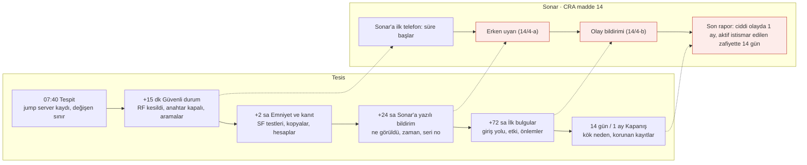
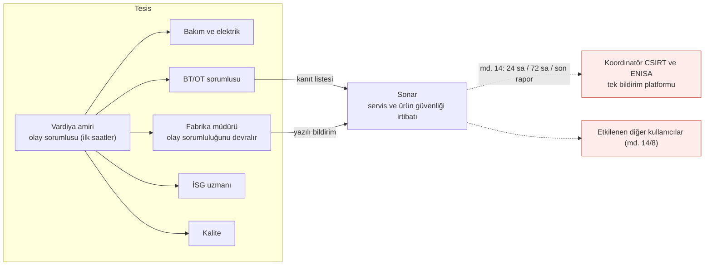

# LABORATUVAR FÖYÜ 6

## Olay Müdahalesi ve CRA Bildirim Zaman Çizelgesi

### 6. hafta

| | |
|---|---|
| **Konu alanı** | CRA Incident Simulation · ilk dakikalardan son rapora olay müdahale akışı |
| **Makine** | Sonar Elektronik Yüksek Frekans Jeneratörü, 60 kW RF çıkış, 13,56 MHz |
| **Hazırlayan** | Beyza Kuzu |

> Bu belge yapay zekâ asistanı Claude (Anthropic) desteğiyle hazırlanmıştır.

## 1. Amaç

Bu föyde, uzak servis kanalı üzerinden yapılmış olabilecek yetkisiz bir değişiklik senaryosu kurulur ve tesisin vereceği tepki zaman çizelgesi hâlinde yazılır. Her aşama için iki şey belirlenir: kimin ne yaptığı ve hangi kanıtın korunduğu. CRA'nın bildirim süreleri, hem üreticinin yükümlülüğü hem de tesisin kendi iç takvimi için kilometre taşı olarak kullanılır.

## 2. Ön bilgi

### 2.1 Senaryo

> Salı, 07:40. Vardiya devrinde vardiya amiri jump server'ın oturum listesine bakıyor. Gece 02:55–03:20 arasında Sonar teknisyeni T. adına açılmış bir uzak servis oturumu görüyor. O saatte açık bir arıza kaydı yok ve kimse servis anahtarını çevirdiğini hatırlamıyor. Anahtar şu an "açık" konumunda.
>
> HMI'nın değişiklik listesinde sol presin ısıtma süresi üst sınırı 90 saniyeden 140 saniyeye çıkmış. Değişiklik yerel onay ekranından geçmiş görünüyor. Onaylayan hesap gece vardiyası amirinin hesabı, ama kendisi böyle bir onay vermediğini söylüyor. Sol pres gece bu ayarla 11 çevrim yapmış. Kalite kontrol bir parçada tutkal hattında kararma bildirmiş. Makine şu an çalışıyor ve olay sorumlusu vardiya amiri.

Senaryo Hafta 3'teki R1'e çok benziyor. Fark şu: Hafta 4'te önerilen önlemler (anahtar, kişisel hesap, yerel onay) var ama bir şekilde aşılmış.

### 2.2 CRA'da kimin ne yükümlülüğü var?

- **Bildirim yükümlülüğü üreticide.** CRA madde 14 bildirimi ürünün üreticisine yükler, burada Sonar. Makine CRA kapsamındaysa Sonar, aktif olarak istismar edilen bir zafiyeti ya da ürünün güvenliğini etkileyen ciddi bir olayı ENISA'ya ve koordinatör CSIRT'e bildirmek zorunda. Madde 14 11 Eylül 2026'dan beri uygulanıyor. Madde 69(3)'e göre bu yükümlülük piyasaya daha önce sürülmüş ürünleri de kapsıyor.
- **Tesisin görevi.** Kullanıcı olarak tesisin CRA'da bir bildirim yükümlülüğü yok. Ancak üreticinin süresi, üreticinin durumdan **haberdar olduğu andan** itibaren işliyor. Tesis Sonar'a ne kadar erken ve ne kadar kanıtla bilgi verirse bildirimler o kadar doğru olur.
- **Gönüllü bildirim.** Madde 15'e göre üretici dışındaki kişiler de bir olayı gönüllü olarak koordinatör CSIRT'e ya da ENISA'ya bildirebilir.

**Tablo 1.** Madde 14'teki süreler

| Durum | Erken uyarı | Bildirim | Son rapor |
|---|---|---|---|
| Aktif olarak istismar edilen zafiyet (md. 14/2) | 24 saat içinde | 72 saat içinde | Düzeltici ya da azaltıcı önlem sunulduktan sonra en geç 14 gün |
| Ürünün güvenliğini etkileyen ciddi olay (md. 14/4) | 24 saat içinde | 72 saat içinde | Olay bildiriminden sonra bir ay içinde |

Bu senaryonun hangi satıra gireceği kök nedene bağlı. Teknisyenin parolası çalındıysa ciddi olay, yönlendiricideki bir açık kullanıldıysa aktif istismar edilen zafiyet. Bu yüzden ilk saatlerde ikisi de açık tutuldu.

İki not daha:

- Tesis AB'deyse ve NIS2 kapsamındaysa tesisin kendi bildirim yükümlülükleri ayrıca doğar.
- Tesis Türkiye'deyse ulusal CERT'in (USOM) bilgilendirilmesi değerlendirilmeli.

Bu iki konu bu föyde araştırılmadı.

## 3. Uygulama

### 3.1 Roller

**Tablo 2.** Olaydaki roller

| Rol | Görevi | Ne zaman devreye girer |
|---|---|---|
| Vardiya amiri | Olay sorumlusu (ilk saatler); makineyi güvenli duruma alma kararı; ilk aramalar | 07:40 |
| Bakım ve elektrik sorumlusu | Makineyi güvenli duruma almak; emniyet fonksiyonu testleri; PLC'den kopya almak | İlk 15 dakika |
| Tesis BT/OT sorumlusu | Kanıt toplama; hesapları devre dışı bırakma; ağ yalıtımı | İlk 15 dakika |
| Fabrika müdürü | Üretim kararı; dış iletişim; olay sorumluluğunu devralma | İlk saat |
| Sonar servis ve ürün güvenliği irtibatı | Kendi kayıtlarını incelemek; teknisyen hesabını kontrol etmek; gerekiyorsa CRA bildirimi | İlk 2 saat |
| İSG uzmanı | Yangın ve yanık riskini değerlendirmek; çalışanların sağlığı | İlk saat |
| Kalite | Gece üretilen parçaları karantinaya almak | İlk saat |

### 3.2 Zaman çizelgesi

**Şekil 1.** Olayın zaman çizelgesi. Üst sıra tesisin yaptıkları, alt sıra Sonar'ın CRA madde 14 kapsamındaki bildirimleri.

### 3.3 07:40–07:55: ilk 15 dakika

İlk üç eylem, sırasıyla:

1. **Makineyi güvenli duruma almak.** Şüpheli sınır hâlâ yüklü ve aşırı ısınma riski sürüyor. Sol presteki çevrim RF kesilerek sonlandırılır, presler açılır ve yeni çevrim başlatılmaz. Acil stop yalnızca o anda bir tehlike varsa kullanılır. PLC'nin ve HMI'nın enerjisi **kesilmez**, çünkü kayıtlar ve bellek içeriği kanıt.
2. **Uzak erişimi kesmek.** Servis anahtarı kapatılır. Ancak yönlendirici ve jump server yeniden başlatılmaz ve kapatılmaz. Yönlendiricinin bazı kayıtları yalnızca bellekte tutuluyor olabilir.
3. **Aramalar.** Bakım sorumlusu ve BT/OT sorumlusu çağrılır. Onlar gelene kadar HMI'ya ve PLC'ye dokunulmaması söylenir. HMI ekranının ve anahtar konumunun fotoğrafı çekilir, saat not edilir.

Fabrika müdürüne ve Sonar'a ilk bilgi bu aşamada telefonla verilir. Sonar'a ilk soru şu: "Gece 02:55'te teknisyen T. sizin bilginiz dahilinde bağlandı mı?"

### 3.4 07:55–09:40: ilk iki saat

**Emniyet katmanı sağlam mı?** Hafta 4'teki gereksinimler üzerinden hızlı bir kontrol yapılır:

- Safety PLC'nin kontrol toplamı okunur ve devreye alma kaydıyla karşılaştırılır (GR-2).
- Işık perdeleri test çubuğuyla denenir. Kabin kapı kilidi ve acil stoplar tek tek tetiklenir (GR-1).
- Reçete sınırları PLC'den **okunur ve kopyalanır**, sonra bilinen son iyi yedekle karşılaştırılır. Geri yükleme kopya alındıktan sonra yapılır (GR-4).

Bu senaryoda kontrollerin geçmesi bekleniyor: sorun emniyet katmanında değil, süreç katmanında.

**Kanıtlar.** Her kanıtın kim tarafından, ne zaman alındığı ve dosyanın özet değeri (hash) bir listeye yazılır.

**Tablo 3.** Korunacak kanıtlar

| Kanıt | Nerede | Kim alır | Nasıl korunur |
|---|---|---|---|
| Uzak oturumun ekran ve komut kaydı | Jump server (Z4) | BT/OT | Kopya alınır, özet değeri kaydedilir; orijinal sunucuda kalır |
| VPN ve MFA kayıtları: kaynak adres, onay zamanı, cihaz | Yönlendirici (V9), MFA servisi | BT/OT ve Sonar | Dışa aktarılır; cihaz yeniden başlatılmaz |
| HMI değişiklik listesi ve kullanıcı oturumları | HMI (V4) | BT/OT | Ekran fotoğrafı ve dışa aktarma |
| PLC programı ve reçete veritabanının şimdiki hâli | Hat PLC'si (V3) | Bakım, Sonar desteğiyle | PLC'den kopya alınır; geri yüklemeden önce |
| Safety PLC kontrol toplamı | Safety PLC (V1) | Bakım | Okunur ve kaydedilir |
| Gece 11 çevrimin anot akımı ve süre kayıtları | PLC, üretim takip PC (V10) | BT/OT | Dışa aktarılır |
| Kararmış parça ve aynı partideki parçalar | Hücre | Kalite | Etiketlenir, karantinaya alınır |
| Anahtar konumu, vardiya defteri, tanık ifadeleri | Hücre | Vardiya amiri | Fotoğraf; yazılı ve tarihli not |
| Cihaz saatleri arasındaki farklar | Bütün cihazlar | BT/OT | Not edilir; zaman çizelgesi bu farklara göre düzeltilir |

**Hangi hesaplar kapatılır?**

- Teknisyen T.'nin hesabı jump server'da ve VPN'de devre dışı bırakılır. Hesap **silinmez**, çünkü kayıtlar ona bağlı.
- Gece vardiyası amirinin HMI hesabının parolası değiştirilir. HMI'da açık kalan oturumlar kapatılır.
- Sonar'dan teknisyenin VPN sertifikasının ya da MFA cihazının iptali istenir.

**Üretim kararı.** Bu karar fabrika müdürünün.

- **Sol pres:** Kanıtlar alınıp sınırlar bilinen iyi değerlere döndürülene kadar durur.
- **Sağ pres:** Sınırları bilinen iyi değerlerle aynıysa ve emniyet kontrolleri geçtiyse, uzak erişim kapalı kaldığı sürece çalışabilir.

### 3.5 24 saat, 72 saat ve son rapor

**Tablo 4.** Kilometre taşları ve hazırlanacak bilgi

| Kilometre taşı | Yasal yükümlülük | Tesisin hazırlayıp Sonar'a verdiği bilgi | Tesiste sorumlu |
|---|---|---|---|
| 24 saat: erken uyarı | Sonar (md. 14/4-a): kötü niyet şüphesi ve ürünün bulunduğu üye devletler | Ne görüldü; zaman aralığı; makinenin seri numarası ve kurulu olduğu ülke; kötü niyetli bir müdahale şüphesi olup olmadığı | Vardiya amiri ve BT/OT |
| 72 saat: olay bildirimi | Sonar (md. 14/4-b): ilk değerlendirme, alınan önlemler, kullanıcıların alabileceği önlemler | İlk bulgular: hangi hesapla, hangi yoldan girildi; neyin değiştiği; etkilenen 11 çevrim; alınan önlemler (hesap kapatma, sınırların geri yüklenmesi, uzak erişimin kapalı tutulması) | BT/OT ve bakım |
| 14 gün ya da 1 ay: son rapor | Sonar: aktif istismar edilen zafiyette, önlem sunulduktan sonra 14 gün; ciddi olayda, bildirimden sonra 1 ay | Kök neden; ayrıntılı etki; uygulanan ve süren önlemler; korunan kayıtların listesi | Fabrika müdürü |

72 saat için örnek ara bulgular (varsayım):

- Anahtarın 2 saatlik otomatik kapanma ayarı iki hafta önceki bir devreye alma oturumunda kapatılmış ve yeniden açılmamış. Bu ayar Hafta 1'deki bağımlılık listesine eklenmeli.
- HMI'da gece vardiyası amirinin oturumu açık kalmış. HMI'da otomatik oturum kapatma yok.
- VPN girişindeki MFA onayı teknisyenin telefonundan verilmiş görünüyor. Telefonun ya da hesabın ele geçirilip geçirilmediğini Sonar inceliyor.

### 3.6 Yapılmaması gerekenler

- **Reçeteyi hemen eski hâline döndürmek.** Önce kopya alınmalı, yoksa neyin değiştiğinin tek kanıtı kaybolur.
- **Yönlendiriciyi, jump server'ı ya da PLC'yi yeniden başlatmak.**
- **Yeni parolaları telefonda ya da toplu mesajla paylaşmak.**
- **Emniyet testleri yapılmadan üretime dönmek.**
- **Sonar'a bildirimi "durum netleşince" diye ertelemek.** Sonar'ın 24 saati, haberdar olduğu anda başlıyor. Netleşmeyi beklemek bu süreyi daraltır.

### 3.7 Haberleşme akışı

**Şekil 2.** Olayda bilginin akışı. Kesikli oklar yasal yükümlülüğün tesiste değil üreticide olduğu adımlar.

## 4. Değerlendirme

Senaryodaki önlemler çökmedi, bakımı yapılmayan ayarlar yüzünden zayıfladı: anahtarın otomatik kapanması kapatılmış, HMI oturumu açık kalmış. Hafta 4'teki mimari doğruydu, ama ayarların zamanla değişip değişmediğini kontrol eden bir süreç yoktu. Önerilen yeni önlem: servis erişimi ve onay ayarları için aylık kısa bir kontrol listesi.

Olay sırasında en çok işe yarayan şey, Hafta 4'te önerilen oturum kaydıydı. Kayıt olmasaydı "kim, ne zaman, ne değiştirdi" sorularının hiçbiri cevaplanamazdı. GR-4 (reçeteden bağımsız üst sınır) uygulanmış olsaydı 140 saniyelik ayar sınırda kesilir, kararmış parça da olmazdı.

CRA'da yükümlülük üreticide, ama süreyi başlatan tesisin verdiği bilgi. Bu yüzden tesisin hazırlığı, Sonar'ın yükümlülüğünü yerine getirebilmesinin ön koşulu.

**Açık sorular**

1. Kök neden çalınmış bir parola çıkarsa bu olay CRA'daki "ürünün güvenliğini etkileyen ciddi olay" tanımına (md. 14/5) giriyor mu, yoksa ürünün değil kullanımın sorunu mu sayılır?
2. Sonar ile yapılan servis sözleşmesine bildirim süreleri ve kanıt paylaşımı yazılmalı mı?

## 5. Kaynaklar

1. Regulation (EU) 2024/2847 (CRA), madde 14, 15, 69(3) ve 71.
2. NIST SP 800-61 Rev. 3, olay müdahalesi önerileri, 2025.
3. ISO/IEC 27035-1:2023, Bilgi güvenliği olay yönetimi, Bölüm 1.
4. IEC 62443-2-1, Varlık sahipleri için güvenlik programı gereksinimleri.
5. Hafta 3 föyü (R1), Hafta 4 föyü (erişim kuralları, GR-1–GR-5), Hafta 5 föyü (SBOM).
