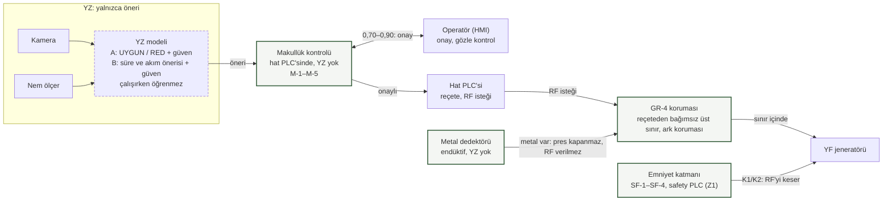
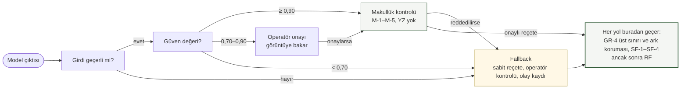

# LABORATUVAR FÖYÜ 7

## Yapay Zekâ Destekli Kontrolde Güvenli Başarısızlık

### 7. hafta

| | |
|---|---|
| **Konu alanı** | AI Safety Challenge · tahmini emniyetten ayırmak |
| **Makine** | Sonar Elektronik Yüksek Frekans Jeneratörü, 60 kW RF çıkış, 13,56 MHz |
| **Hazırlayan** | Beyza Kuzu |

> Bu belge yapay zekâ asistanı Claude (Anthropic) desteğiyle hazırlanmıştır.

## 1. Amaç

Bu föyde yapıştırma hücresine eklenen bir yapay zekâ (YZ) modülü üç ayrı başarısızlık için incelenir:

- **Yanlış sınıflandırma:** model kusurlu bir parçaya "uygun" diyor.
- **Bozuk ya da sahte girdi:** modele gelen görüntü bozuk ya da sahte.
- **Düşük güven:** model kararından emin değil.

Her biri için sistemin nasıl güvenli davranacağı tanımlanır. Temel tasarım kararı şudur: modelin kararı bir tahmindir. İnsanı ve makineyi koruyan yapı modelin dışında kalmalıdır.

## 2. Ön bilgi

### 2.1 Varsayılan YZ modülü

Standart jeneratörde böyle bir modül yok (makine-bilgisi.md, VS-12). Hücreye şu modülün eklendiği varsayıldı:

- **Girdiler:** pres önündeki kamera kalıba dizilen kaplama yığınını görüntüler. Bir nem ölçer lamellerin nemini ölçer.
- **Görev A, giriş kontrolü:** Model yığını "UYGUN" ya da "RED" diye sınıflandırır. Aradığı kusurlar zımba teli ya da çivi gibi metal parçalar, katlanmış kaplama ve eksik tutkal. Metal parça bu makinede özellikle önemli, çünkü elektrotlar arasında ark ve yangın başlatabilir (Hafta 1, T3).
- **Görev B, reçete önerisi:** Model nem ve kalınlığa göre ısıtma süresi ve anot akımı önerir. Öneri hat PLC'sine gider.
- Model ayrı bir endüstriyel bilgisayarda çalışır ve kendi kendine öğrenmez. Yeni model sürümleri tesis dışında eğitilir ve Hafta 5'teki yama yolu gibi testten geçerek yüklenir.

### 2.2 Bu tasarımın mevzuattaki yeri

- **2023/1230 Ek I Bölüm A madde 5 ve 6.** Makine öğrenmesiyle kendi davranışını geliştiren ve emniyet fonksiyonu sağlayan emniyet bileşenleri ile bu tür sistemleri içeren makineler üçüncü taraf uygunluk değerlendirmesi gerektirir. Gerekçe bölümünün 55. maddesine göre bu hüküm öğrenmeyen, yalnızca programlandığı işi yapan yazılıma uygulanmaz.
- **Bu föydeki tasarım.** Model emniyet fonksiyonu sağlamıyor ve çalışırken öğrenmiyor. Emniyet SF-1–SF-4'te ve Hafta 4'teki GR-4 korumasında kalıyor. Bu, modülü o kategorinin dışında tutmaya yönelik bilinçli bir karar. Kesin sınıflandırma uzman değerlendirmesi ister.
- **2023/1230 Ek III madde 1.2.1(d).** Emniyet fonksiyonlarının sınırlarında, öğrenme aşaması dahil, tehlikeli duruma yol açabilecek değişikliğe izin verilmiyor. Bu yüzden yeni bir model sürümü sınırları hiçbir zaman değiştiremez.
- **AI Act (2024/1689).** 2026/1744 sayılı Digital Omnibus ile değiştirildi (OJ 24.7.2026). Ek I'e bağlı yüksek riskli YZ sistemleri için Bölüm III kuralları 2 Ağustos 2028'den itibaren uygulanacak. Makine mevzuatı Ek I'in A bölümünden çıkarıldı ve 2023/1230 olarak B bölümüne eklendi. Komisyon, 2023/1230 Ek III'e yüksek riskli YZ sistemleri için gereklilikleri delege tasarrufla ekleyecek. Emniyet bileşeni olmayan bu modülün yüksek riskli sayılmayacağı bir yorum, kesin bir sonuç değil.

## 3. Uygulama

### 3.1 Mimari: modelin yeri

**Şekil 1.** YZ modülünün hücredeki yeri. Modelin çıktısı yalnızca öneridir; makullük kontrolü, reçeteden bağımsız üst sınırlar ve emniyet katmanı modelden bağımsız çalışıyor.

Model ile RF enerjisi arasında modelden bağımsız üç katman var:

1. **Makullük kontrolü.** Hat PLC'sinde, YZ olmayan sabit kurallar (Tablo 2).
2. **Reçeteden bağımsız üst sınır ve ark koruması.** Hafta 4, GR-4.
3. **Emniyet katmanı.** SF-1–SF-4. Pres açıkken ya da koruma alanında biri varken RF'yi zaten keser.

Model bu katmanların hiçbirini değiştiremez. Model tamamen yanlış çalışsa bile en kötü sonuç, sınırlar içinde kalan kötü bir reçete ve hurda parça olur.

Metal parça için ayrıca **endüktif metal dedektörü** önerildi. Bu, YZ olmayan ikinci bir kontrol. Metal parçanın sonucu ark ve yangın olabildiği için bu kontrol yalnızca modele bırakılmadı.

### 3.2 Başarısızlık 1: yanlış sınıflandırma

**Durum.** İçinde bir zımba teli kalmış yığına model "UYGUN" diyor.

- **İkinci kontrol.** Metal dedektörü teli algılar ve presin kapanmasına izin vermez. Dedektörün kararı modelin kararından önce gelir: dedektör "metal var" diyorsa model "uygun" dese bile parça reddedilir.
- **İkisi de kaçırırsa.** Ark oluştuğunda paneldeki anot aşırı akım koruması ve GR-4 RF'yi keser. Bu durumda zarar kalıpta ve parçada kalır, yangına dönüşmez.
- **İzleme.** Her vardiya başında içinde bilinen bir metal parça bulunan test yığını kameraya ve dedektöre gösterilir. İkisinin de reddetmesi beklenir. Biri geçirirse modül devre dışı kalır ve operatör yığını gözle kontrol eder.
- **Geri bildirim.** Kaçırılan her kusur kaydedilir ve bir sonraki model sürümünün eğitim verisine eklenir. Model çalışırken kendini değiştirmez.

### 3.3 Başarısızlık 2: bozuk ya da sahte girdi

**Durum.** Kamera görüntüsü donmuş, lens buhar ve tutkal buğusuyla kirlenmiş ya da Z2'ye ulaşan biri modele eski bir görüntüyü tekrar tekrar gönderiyor. Bu makinede lensin kirlenmesi gerçekçi bir risk, çünkü RF ile ısınan nemli ahşap buhar çıkarıyor.

**Nasıl fark edilir?**

- Görüntünün zaman damgası ya da kare sayacı ilerlemiyor.
- Kalıbın kenarındaki sabit referans işareti görüntüde yok, ya da yeri ve keskinliği beklenen aralıkta değil.
- Ardışık iki yığının görüntüsü birebir aynı.
- Nem ölçerin değeri ile model girdisi arasında tutarsızlık var. Örneğin nem çok değiştiği hâlde öneri aynı.
- Görüntünün parlaklık ve keskinlik değerleri normal aralığın dışında.

**Ne yapılır?** Girdi geçersiz sayılır ve modelin çıktısı kullanılmaz.

- **Görev A için:** operatör yığını gözle kontrol eder ve HMI'da onaylar. Metal dedektörü çalışmaya devam eder.
- **Görev B için:** ürün kartındaki sabit, önceden doğrulanmış reçete kullanılır.
- **Kayıt ve alarm:** olay kaydedilir. Aynı vardiyada üç kez tekrarlanırsa bakım ekibine alarm gider. Sahte görüntü şüphesi varsa Hafta 6'daki olay akışı başlatılır.

### 3.4 Başarısızlık 3: düşük güven

**Durum.** Hücreye yeni bir ağaç türü ya da alışılmadık kalınlıkta bir lamel geliyor. Model kararını düşük güvenle veriyor.

**Tablo 1.** Güven eşikleri (başlangıç değerleri)

| Model güveni | Görev A: giriş kontrolü | Görev B: reçete önerisi |
|---|---|---|
| 0,90 ve üstü | Karar kullanılır; metal dedektörü yine çalışır | Öneri makullük kontrolüne gider |
| 0,70–0,90 | Operatör HMI'da görüntüye bakıp onaylar | Öneri operatöre gösterilir; operatör onaylarsa makullük kontrolüne gider |
| 0,70'in altında | Model devre dışı; operatör gözle kontrol eder | Sabit reçete kullanılır; kalite örneklemesi artırılır |

Eşikler deneme üretiminde ölçülecek hata oranlarına göre ayarlanmalı. 0,90 ve 0,70 yalnızca başlangıç değerleri. Görev A'da hatanın bedeli daha yüksek (ark, yangın). Bu yüzden Görev A için daha yüksek bir eşik seçilmesi de düşünülebilir.

**Şekil 2.** Bir model çıktısının izlediği yol. Hangi dalda olursa olsun RF'ye giden yol makullük kontrolünden, bağımsız sınırlardan ve emniyet katmanından geçiyor.

### 3.5 Makullük kontrolü kuralları

Bu kurallar hat PLC'sinde çalışır, YZ içermez ve model sürümünden bağımsızdır.

**Tablo 2.** Makullük kontrolü

| No | Kural | Reddedilirse |
|---|---|---|
| M-1 | Önerilen süre ve akım ürün kartındaki aralıkta olmalı | Sabit reçete |
| M-2 | Bir önceki çevrime göre değişim en fazla %15 olmalı | Operatör onayı |
| M-3 | Nem arttıysa süre azalamaz; nem azaldıysa süre artamaz | Sabit reçete ve kayıt |
| M-4 | Aynı partide ardışık üç öneri arasında büyük bir sıçrama olmamalı | Operatör onayı |
| M-5 | Model sürümü onaylı sürüm listesinde olmalı | Model devre dışı |

M-1'deki aralık reçete sınırıdır. GR-4'teki üst sınır onun da üstünde ayrı bir sınırdır ve model ya da makullük kontrolü onu değiştiremez.

### 3.6 Karar tablosu

**Tablo 3.** Güvenli başarısızlık kararları

| Başarısızlık | Nasıl fark edilir | Güvenli davranış | Kullanılan kavram | Emniyet nerede kalıyor |
|---|---|---|---|---|
| Yanlış sınıflandırma | Metal dedektörü uyuşmazlığı; vardiya başı test yığını; kalite geri bildirimi | Dedektör kararı öncelikli; kaçan kusurda anot koruması ve GR-4 RF'yi keser; test başarısızsa modül devre dışı | Fail-safe, monitoring | Metal dedektörü, anot koruması, GR-4 |
| Bozuk ya da sahte girdi | Donmuş kare, referans işareti, aynı görüntü, nem tutarsızlığı | Çıktı kullanılmaz; operatör kontrolü ve sabit reçete; tekrar ederse alarm, sahtelik şüphesinde olay akışı | Monitoring, fallback, human override | Makullük kontrolü, GR-4, SF-1–SF-4 |
| Düşük güven | Model güven değeri | 0,90 ve üstü otomatik; 0,70–0,90 operatör onayı; altında sabit reçete | Confidence threshold, human override, fallback | Makullük kontrolü, GR-4 |

### 3.7 Modülün getirdiği yeni dijital bağımlılıklar

Hafta 1'deki Tablo 6'ya eklenmesi gereken satırlar:

**Tablo 4.** YZ modülünün dijital bağımlılıkları

| No | Bağımlılık | Nerede | Kim değiştirebilir | Değişirse ne olur |
|---|---|---|---|---|
| D8 | Model dosyası ve sürümü | YZ bilgisayarı | Modül tedarikçisi, onaylı yükleme ile | Sınıflandırma ve öneriler değişir; M-5 onaysız sürümü durdurur |
| D9 | Güven eşikleri | YZ bilgisayarı ya da PLC | Proses mühendisi | Eşik düşerse daha çok karar insansız verilir |
| D10 | Makullük kuralları (M-1–M-5) | Hat PLC'si | PLC programcısı | Kötü öneriler süzülmeden PLC'ye ulaşır; GR-4 son savunma olarak kalır |
| D11 | Kamera konumu, odak ve referans işareti | Hücre | Bakım | Girdi kontrolü yanlış alarm verir ya da sahte görüntüyü kaçırır |
| D12 | Metal dedektörü hassasiyeti | Dedektör | Bakım | Küçük metal parçalar kaçar, ark riski artar |

Modül yeni bir saldırı kapısı da ekliyor: G5, Z2'deki kamera ve YZ bilgisayarı (Hafta 3'teki G1–G4'e ek).

## 4. Değerlendirme

Bu föyün sonucu, YZ modülünün emniyet zincirinde hiçbir halka olmaması gerektiği. Model iyi çalıştığında hurdayı azaltır, kötü çalıştığında hurdayı artırır. İnsanı koruyan şeyler modelden bağımsız: SF-1–SF-4, GR-4 ve metal dedektörü. Bu bağımsızlığı sağlayan şey, modelin yalnızca öneri vermesi ve her önerinin YZ içermeyen bir kontrolden geçmesi.

Metal parça örneği yeni bir soru doğurdu. Metal parçanın sonucu ark ve yangın olabiliyor. Bu durumda metal dedektörü bir kalite aracı mı, yoksa Hafta 4'te önerilen beşinci emniyet fonksiyonunun (aşırı ısınma ve arkta RF'nin kesilmesi) bir girişi mi? Bu föyde ikinci yorum benimsendi ve dedektör YZ'den ayrı tutuldu.

Yedi haftaya birlikte bakınca: Hafta 3–4 en tehlikeli yolun emniyet fonksiyonlarına dokunmadan reçete üzerinden yangına gittiğini gösterdi. Hafta 5–6'da bu yolun bir yazılım açığıyla ya da çalınmış bir hesapla, Hafta 7'de ise bir YZ önerisiyle açılabileceği görüldü. Üç durumda da çözüm aynı: reçeteden ve kontrol yazılımından bağımsız bir üst sınır.

**Açık sorular**

1. Tesis dışında yeniden eğitilip yüklenen bir model sürümü, 2023/1230 Ek III 1.2.1(d)'deki "öğrenme aşaması" kapsamında mı sayılır?
2. Güven eşikleri bir proses parametresi mi, yoksa değişiklik kontrolüne tabi bir güvenlik ayarı mı?

## 5. Kaynaklar

1. Regulation (EU) 2023/1230, Ek I Bölüm A madde 5 ve 6, gerekçe 55, Ek III madde 1.2.1.
2. Regulation (EU) 2024/1689 (AI Act), madde 6 ve 113.
3. Regulation (EU) 2026/1744 (Digital Omnibus on AI), OJ L, 24.7.2026.
4. ISO/IEC TR 5469:2024, Yapay zekâ: fonksiyonel emniyet ve YZ sistemleri.
5. ISO/IEC 23894:2023, Yapay zekâ: risk yönetimi rehberi.
6. Hafta 1, 3, 4, 5 ve 6 föyleri; makine-bilgisi.md (VS-12).
